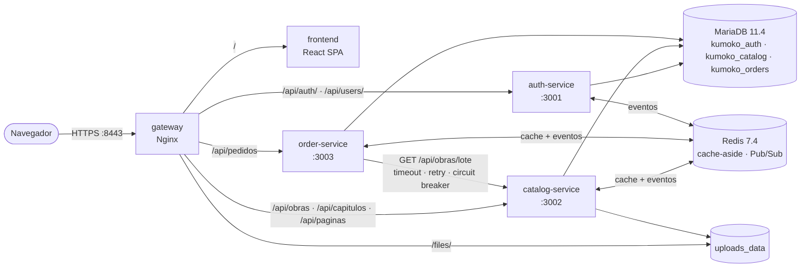
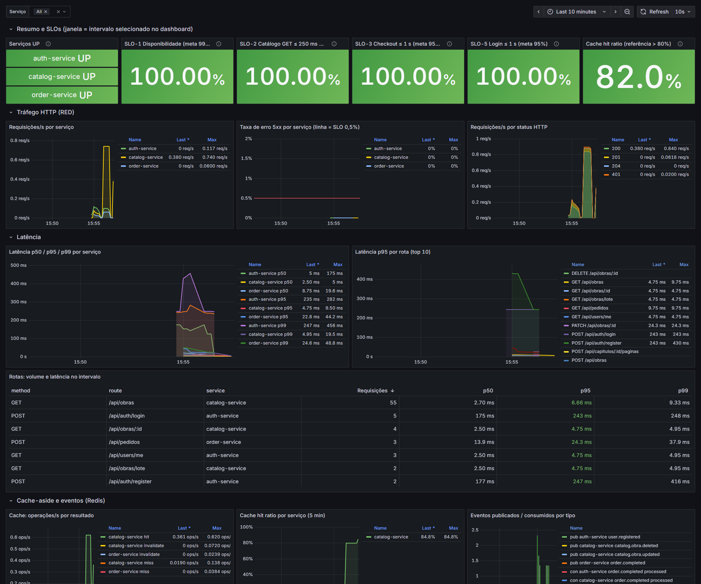
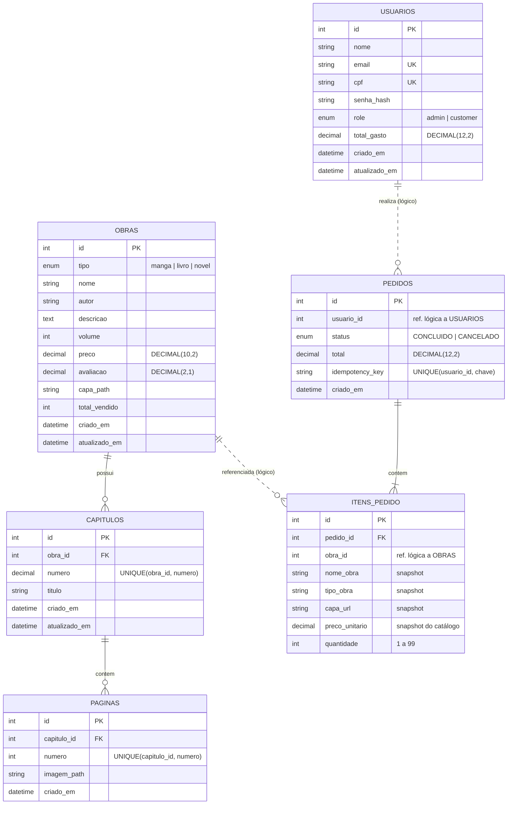
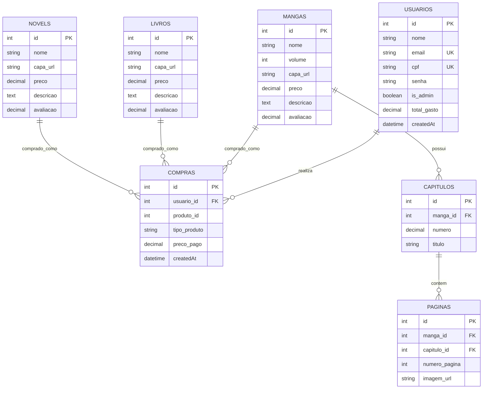
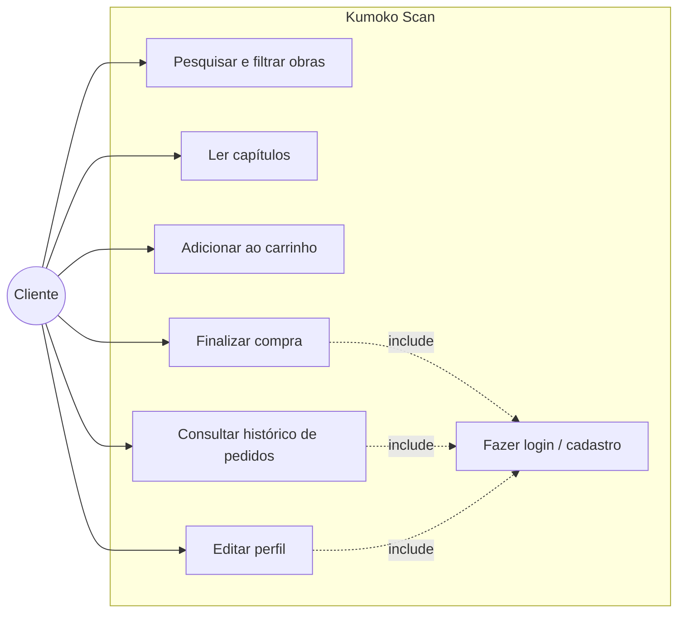
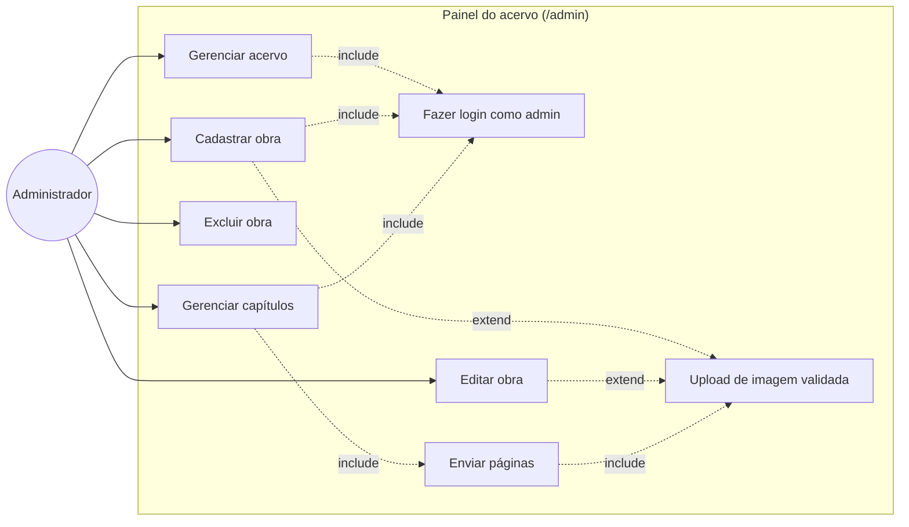
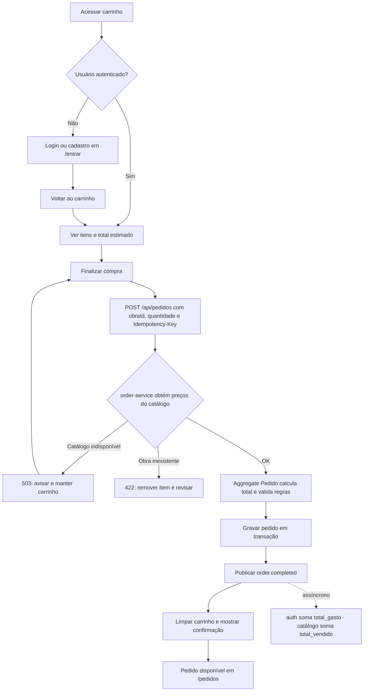
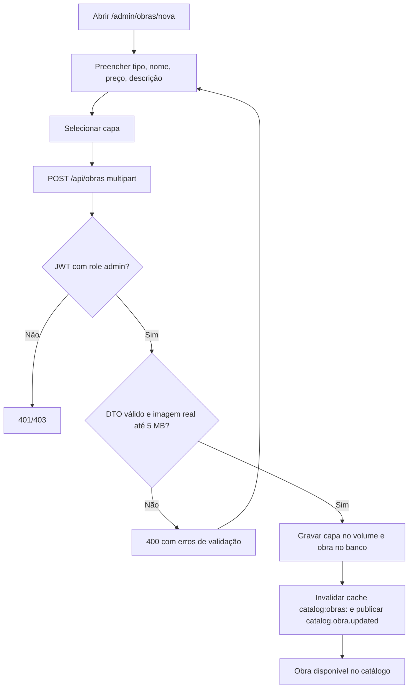
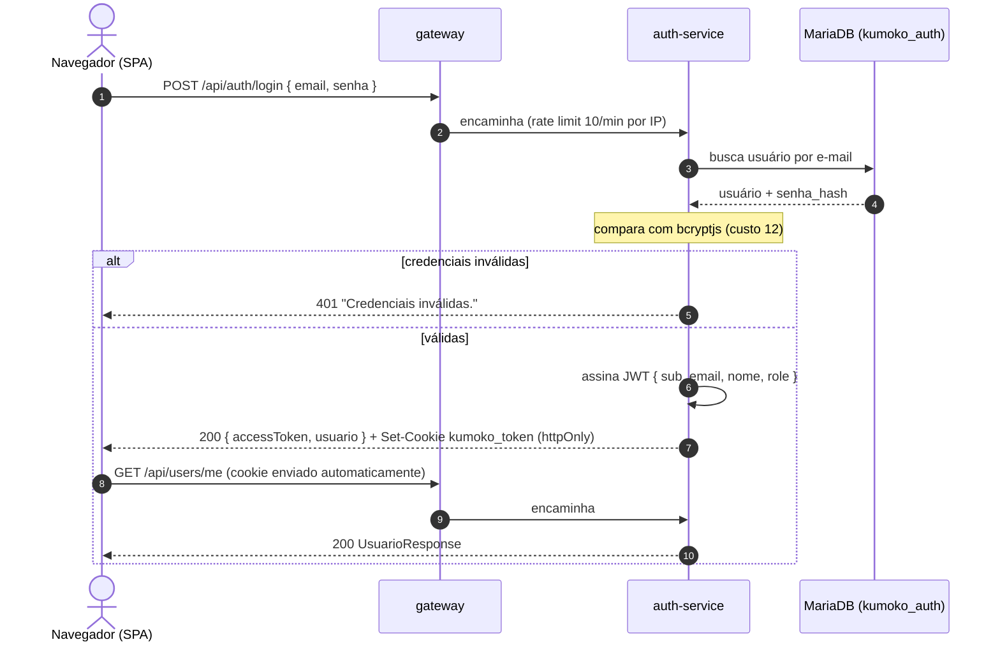

# Kumoko Scan — E-commerce e leitura de mangás, livros e light novels

Plataforma web para navegar em um acervo de obras, ler capítulos online e comprar
mangás, livros e light novels, com painel administrativo para manter o acervo.

A versão **1.0.0** reorganiza o projeto em **três microsserviços NestJS** atrás de um
**gateway Nginx**, com **MariaDB** (um database por serviço), **Redis** (cache
distribuído e mensageria Pub/Sub) e um frontend **React**, tudo orquestrado com
**Docker Compose**.

- Documentação completa (C4, ADRs, DDD, OpenAPI, SLOs, runbook, backlog): [`docs/README.md`](docs/README.md)
- Histórico de versões: [`CHANGELOG.md`](CHANGELOG.md)

---

## Sumário

1. [Contextualização do problema e evolução do produto](#contextualização-do-problema-e-evolução-do-produto)
2. [Arquitetura](#arquitetura)
3. [Como rodar](#como-rodar)
4. [Demonstrações: cache e eventos](#demonstrações-cache-e-eventos)
5. [Testes e qualidade](#testes-e-qualidade)
6. [Estrutura de pastas](#estrutura-de-pastas)
7. [Modelo de dados](#modelo-de-dados)
8. [Casos de uso e fluxos](#casos-de-uso-e-fluxos)
9. [Requisitos](#requisitos)
10. [Evolução no Git](#evolução-no-git)

---

## Contextualização do Problema e Evolução do Produto

O projeto consiste no desenvolvimento de uma plataforma de comércio eletrônico voltada para a comercialização e leitura de mangás, livros e light novels.

A necessidade do sistema surgiu a partir da dificuldade de centralizar o acervo de publicações independentes e traduções. Inicialmente, o público e os leitores entravam em contato de forma descentralizada para verificar disponibilidade de volumes, lançamentos e informações sobre capítulos. Esse modelo gerava um atendimento manual, pouco escalável e com baixa organização.

Diante desse problema, o produto foi evoluindo ao longo do tempo para atender melhor às demandas do público e da operação do negócio.

### Primeira versão — Catálogo online (v0.1.0)

A primeira versão teve como objetivo principal disponibilizar o acervo de obras na internet, reduzindo a necessidade de contato direto para consultas simples. Foi desenvolvido um site que apresentava as obras disponíveis e suas capas, permitindo que o leitor consultasse previamente o catálogo.

No entanto, essa etapa ainda não oferecia um processo de compra integrado. Quando o usuário se interessava por uma obra, o fluxo dependia de contato externo para concluir a transação manualmente.

### Segunda versão — Implementação do e-commerce (v0.2.0)

A segunda versão surgiu para transformar o catálogo em uma plataforma de comércio eletrônico completa, permitindo que o cliente realizasse compras diretamente pelo sistema.

Nessa etapa, foi criada uma área administrativa, conhecida como "Painel do Administrador" ou "Mestre das Sombras", responsável por gerenciar todo o acervo. Foram implementadas funcionalidades essenciais para os clientes, como:

- Cadastro de usuários com validação de CPF e e-mail;
- Login e autenticação baseada em JWT;
- Gerenciamento de conta;
- Carrinho de compras global;
- Seleção de produtos e finalização de pedidos;
- Histórico de compras integrado ao banco de dados.

### Terceira versão — Expansão para dispositivos móveis (v0.3.0)

Na terceira versão, o objetivo foi ampliar o acesso à plataforma por meio de um aplicativo móvel desenvolvido com React Native e Expo, permitindo que leitores navegassem pelo catálogo e realizassem compras pelo celular.

O aplicativo foi depois arquivado em `archive/mobile`: o foco voltou para a aplicação web responsiva, que atende celular e desktop com uma única base de código. As telas do mobile (catálogo, detalhes, carrinho, histórico e gerenciamento do acervo) serviram de referência para o novo frontend web.

### Quarta versão — Reestruturação em microsserviços (v1.0.0)

Uma auditoria técnica do monólito Express (novembro de 2026) encontrou problemas que não se resolviam com remendos: o cadastro público podia conceder papel de administrador, o segredo do JWT tinha valor padrão no código, o preço da compra vinha do navegador, o schema do banco era alterado automaticamente no boot e não havia fronteira entre catálogo e vendas.

A v1.0.0 reescreve o backend em três serviços alinhados aos contextos do negócio (Identidade, Catálogo e Leitura, Vendas), com preço sempre calculado no servidor, checkout idempotente e resiliente, cache distribuído, eventos entre serviços, observabilidade e entrega contínua. A justificativa e os trade-offs estão na [ADR-001](docs/arquitetura/adr/ADR-001-microsservicos.md).

---

## Arquitetura



| Serviço (Compose) | Tecnologia | Porta interna | Publicada no host | Responsabilidade |
|---|---|---|---|---|
| `gateway` | Nginx 1.27 | 80, 443 | **8080**, **8443** | TLS, cabeçalhos de segurança, rate limit, `X-Request-Id`, roteamento, `/files/` |
| `frontend` | React 19 + Vite 7 + Tailwind v4 (nginx:alpine) | 80 | — | SPA: catálogo, leitor, carrinho, pedidos, perfil, admin |
| `auth-service` | NestJS + TypeORM | 3001 | — | Cadastro, login (JWT em cookie httpOnly), perfil, total gasto |
| `catalog-service` | NestJS + TypeORM | 3002 | — | Obras, capítulos, páginas, uploads, cache do catálogo |
| `order-service` | NestJS + TypeORM | 3003 | — | Checkout (aggregate `Pedido`), idempotência, histórico |
| `mariadb` | MariaDB 11.4 | 3306 | — | Um database e um usuário por serviço |
| `redis` | Redis 7.4 | 6379 | — | Cache-aside (`catalog:*`, `orders:*`) e Pub/Sub (`kumoko.events.*`) |
| `prometheus` | Prometheus 3.5 | 9090 | — | Coleta `/metrics` dos 3 serviços a cada 10 s; regras de alerta |
| `grafana` | Grafana OSS 12.1 | 3000 | — (via gateway em `/grafana/`) | Dashboard provisionado com RED, SLOs, cache, eventos e circuit breaker |

Eventos trocados pelo Redis Pub/Sub:

| Evento | Publicado por | Consumido por | Efeito |
|---|---|---|---|
| `order.completed` | order-service | auth-service, catalog-service | soma `total_gasto` do usuário; soma `total_vendido` das obras e invalida o cache |
| `catalog.obra.updated` / `catalog.obra.deleted` | catalog-service | order-service | invalida o cache de preços |
| `user.registered` | auth-service | order-service | log de auditoria |

Mais detalhes: [C4](docs/arquitetura/c4.md) · [DDD e Context Map](docs/arquitetura/ddd.md) ·
[ADRs](docs/README.md#adrs) · [OpenAPI](docs/api/openapi.yaml).

---

## Como rodar

### Pré-requisitos

- Docker Engine 24+ com Docker Compose v2 (`docker compose version`)
- Portas **8080** e **8443** livres no host
- Para desenvolvimento fora do Docker: Node.js 22 e npm 10

### Subir o ambiente

```bash
cp .env.example .env          # ajuste senhas e o JWT_SECRET (mínimo 32 caracteres)
docker compose up -d --build --wait
docker compose ps             # todos os serviços devem aparecer como healthy
```

Na primeira subida o MariaDB cria os três databases, cada serviço aplica suas
migrations, o `auth-service` cria o administrador a partir de `ADMIN_*` e o
`catalog-service` semeia o catálogo com as capas de exemplo (`SEED_CATALOG=true`).

### Acessar

1. Abra **https://localhost:8443** (http://localhost:8080 redireciona para HTTPS).
2. O certificado é **autoassinado** e gerado na subida do gateway: aceite o aviso do
   navegador ("Avançado" → "Continuar para localhost").
3. Entre como administrador com `ADMIN_EMAIL` / `ADMIN_PASSWORD` do seu `.env`
   (no `.env.example`: `admin@kumoko.local` / `Admin@Kumoko2026` — troque em qualquer
   ambiente compartilhado). O painel fica em **/admin/acervo**.
4. Para comprar, crie uma conta de cliente em **/entrar** (CPF precisa ser válido).
5. Observabilidade: **https://localhost:8443/grafana/** (usuário `admin`, senha
   `GRAFANA_ADMIN_PASSWORD` do `.env`). O dashboard **Kumoko Scan — Visão geral** abre
   como página inicial. Detalhes em [docs/operacao/observabilidade.md](docs/operacao/observabilidade.md).



### Swagger de cada serviço

| Serviço | URL |
|---|---|
| auth-service | https://localhost:8443/api/auth/docs |
| catalog-service | https://localhost:8443/api/catalog/docs |
| order-service | https://localhost:8443/api/orders/docs |
| Contrato consolidado | [`docs/api/openapi.yaml`](docs/api/openapi.yaml) |

No Swagger, faça login em `POST /api/auth/login` e use o `accessToken` no botão
**Authorize** (Bearer). `/health` e `/metrics` dos serviços não são expostos pelo
gateway; consulte-os dentro da rede, por exemplo
`docker compose exec catalog-service wget -qO- http://127.0.0.1:3002/health`.

### Parar

```bash
docker compose down        # mantém os dados
docker compose down -v     # apaga banco, Redis, uploads e certificado (cuidado)
```

### Frontend em modo desenvolvimento

Com a stack no ar, o Vite repassa `/api` e `/files` para o gateway:

```bash
cd frontend
npm ci
npm run dev                # http://localhost:5173
```

---

## Demonstrações: cache e eventos

```bash
bash scripts/smoke-test.sh   # fluxo crítico: health, login, catálogo, checkout
bash scripts/demo-cache.sh   # X-Cache MISS → HIT → invalidação no update → MISS
bash scripts/demo-events.sh  # pedido → order.completed → consumidores (logs + totalGasto)
```

Acompanhe ao vivo:

```bash
docker compose logs -f catalog-service order-service | grep -E 'Cache (HIT|MISS|INVALIDATE)'
docker compose logs -f auth-service catalog-service order-service | grep -E 'Evento (publicado|recebido|processado)'
```

O passo a passo manual (com `redis-cli PSUBSCRIBE 'kumoko.events.*'`, TTL das chaves e
falha do Redis) está em [`docs/operacao/cache-e-mensageria.md`](docs/operacao/cache-e-mensageria.md).

---

## Testes e qualidade

```bash
# Backend (monorepo NestJS)
cd backend
npm ci
npm run lint
npm test                   # Jest: domínio de Pedido, CPF, cache, guards, EventBus, CatalogClient, AuthService
npm run build

# Frontend
cd ../frontend
npm ci
npm run lint
npm run build
```

A CI (`.github/workflows/ci.yml`) roda esses passos, sobe a stack com
`docker compose up -d --build --wait` e executa `scripts/smoke-test.sh`. Detalhes em
[`docs/operacao/deploy.md`](docs/operacao/deploy.md).

---

## Estrutura de pastas

```
kumoko-scan/
├── backend/                   Monorepo NestJS
│   ├── apps/
│   │   ├── auth-service/      Identidade e Acesso (:3001)
│   │   ├── catalog-service/   Catálogo e Leitura (:3002) + seed/covers
│   │   └── order-service/     Vendas / Pedidos (:3003)
│   ├── libs/                  @kumoko/common, security, observability, cache, messaging
│   └── Dockerfile             multi-stage, ARG APP=<serviço>
├── frontend/                  React 19 + Vite 7 + Tailwind v4
├── infra/
│   ├── nginx/                 gateway (TLS, rotas, segurança)
│   └── mariadb/init/          criação dos databases por serviço
├── scripts/                   smoke-test.sh, demo-cache.sh, demo-events.sh
├── docs/                      arquitetura, API, operação e gestão
├── .github/workflows/ci.yml   pipeline CI/CD
├── docker-compose.yml
├── .env.example
└── CHANGELOG.md
```

---

## Modelo de dados

Cada serviço tem seu próprio database; não há chave estrangeira entre bancos. As linhas
pontilhadas abaixo são **referências lógicas** (ids copiados), não FKs.



Auth e catálogo também têm a tabela `eventos_processados(event_id PK, tipo, processado_em)`,
usada para processar cada evento uma única vez.

<details>
<summary>Modelo do monólito legado (v0.1 a v0.4), para comparação</summary>



Principais mudanças: três tabelas de produto viraram `obras.tipo`; `compras` virou
`pedidos` + `itens_pedido` com snapshot do preço; `is_admin` virou `role`; cada contexto
ganhou seu próprio database.

</details>

---

## Casos de uso e fluxos

### Casos de uso — cliente



### Casos de uso — administrador



### Atividade — checkout



### Atividade — cadastro de obra pelo administrador



### Sequência — login



A sequência completa do checkout, com retry, circuit breaker e eventos, está em
[`docs/arquitetura/c4.md`](docs/arquitetura/c4.md#visão-dinâmica--checkout-post-apipedidos).

---

## Requisitos

### Funcionais

**Identidade e acesso**
- RF01: Cadastro de clientes com nome, e-mail, CPF (válido) e senha; e-mail e CPF únicos.
- RF02: Login com e-mail e senha, emitindo JWT entregue em cookie httpOnly (e no corpo para ferramentas).
- RF03: Logout removendo o cookie de sessão.
- RF04: Papéis `customer` e `admin`; o cadastro público cria apenas `customer` e o admin é provisionado pela configuração.
- RF05: Consulta e edição do perfil, com troca de senha mediante a senha atual.

**Catálogo e leitura**
- RF06: Listagem paginada de obras com filtro por tipo, busca por nome e ordenação (recentes, nome, preço, mais vendidos).
- RF07: Detalhe da obra com capítulos ordenados.
- RF08: Leitura de capítulo com todas as páginas em ordem.

**Gestão do acervo (admin)**
- RF09: Cadastro, edição e exclusão de obras com capa (remoção física dos arquivos na exclusão).
- RF10: Cadastro, edição e exclusão de capítulos (número único por obra).
- RF11: Envio e exclusão de páginas de capítulos.

**Vendas**
- RF12: Carrinho no navegador com ajuste de quantidades e remoção de itens.
- RF13: Finalização do pedido com preços obtidos do catálogo no servidor; o cliente envia apenas obra e quantidade.
- RF14: Checkout idempotente por `Idempotency-Key`.
- RF15: Histórico paginado de pedidos do usuário autenticado.
- RF16: Atualização do total gasto do cliente e do total vendido das obras após cada pedido.

### Não funcionais

**Segurança**
- RNF01: Senhas com hash `bcryptjs` custo 12 e política mínima (8 caracteres, letra e número).
- RNF02: JWT assinado com segredo obrigatório de no mínimo 32 caracteres, sem valor padrão.
- RNF03: Negação por padrão em todas as rotas; rotas públicas e administrativas declaradas explicitamente.
- RNF04: Uploads limitados a 5 MB, apenas jpg/png/webp validados por conteúdo.
- RNF05: HTTPS no gateway, cabeçalhos de segurança, CSP sem CDNs e rate limit.

**Arquitetura e manutenibilidade**
- RNF06: Backend em TypeScript com NestJS, organizado em módulos, controllers, services, DTOs e repositórios.
- RNF07: Um database MariaDB por serviço, com migrations versionadas.
- RNF08: Integração entre serviços por HTTP com timeout, retry e circuit breaker, e por eventos Redis Pub/Sub.
- RNF09: Contratos documentados em OpenAPI 3.1 e Swagger por serviço.

**Operação**
- RNF10: Execução completa com `docker compose up`, healthchecks e reinício automático.
- RNF11: Logs JSON com `X-Request-Id` e métricas Prometheus por serviço.
- RNF12: Testes automatizados (Jest) e pipeline de CI com smoke test.
- RNF13: Metas de SLO definidas em [`docs/operacao/slo-sli.md`](docs/operacao/slo-sli.md).

---

## Evolução no Git

| Data | Commit | Marco |
|---|---|---|
| 2026-06-06 | `a8df96b` | Estrutura inicial com backend Express e frontend React unidos |
| 2026-06-21 | `1f8a476` | Correções no Sequelize, roteamento do Express e CSP do Nginx |
| 2026-06-23 | `5891a10` | `.env.example`, correção do `JWT_SECRET` e cabeçalhos no Nginx |
| 2026-06-25 | `945adb9`, `b5a7795` | Busca por id, correção da tela de edição, testes e2e de perfil (**v0.1.0**) |
| 2026-09-08 | `f809bbe` | Primeira versão do app mobile |
| 2026-09-14 | `3871f23` | Integração final de auth, navegação e upload de arquivos (**v0.2.0**) |
| 2026-09-17 | `259336b`, `c5a8fa5` | Diagramas Mermaid, fluxo de e-commerce, gerenciamento do acervo no mobile (**v0.3.0**) |
| 2026-11-09 | `53753f6`, `537587b` | Testes de integração, protótipo NestJS, remoção da chave TLS versionada |
| 2026-11-12 | `0a15e7d` | Ajustes no protótipo NestJS (**v0.4.0**) |
| 2026-11 | branch `refactor/microsservicos` | Reestruturação em microsserviços (**v1.0.0**) |

Detalhes por versão no [`CHANGELOG.md`](CHANGELOG.md); convenções de versionamento e
plano de releases em [`docs/gestao/backlog.md`](docs/gestao/backlog.md#6-versionamento-e-lançamentos-parciais).

## Início rápido no Windows e acesso ao banco

- **`iniciar.cmd`** (dois cliques): cria o `.env` se faltar, sobe os containers e abre https://localhost:8443.
- **DBeaver** (tipo MariaDB): host `127.0.0.1`, porta `3307` (altere com `DB_HOST_PORT` no `.env`),
  usuário `root` e senha `MARIADB_ROOT_PASSWORD` do `.env`. A porta só existe em desenvolvimento
  (`docker-compose.override.yml`) e só é visível no próprio computador.
- As senhas do banco são gravadas na **primeira subida**: mudar o `.env` depois não altera o banco já criado.
