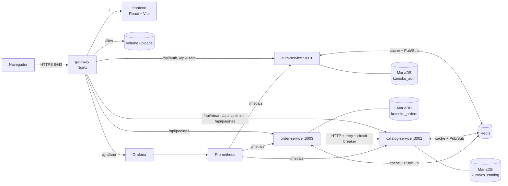

# Kumoko Scan — Mapa da Rubrica (Tech Forge: Arquitetura de Software + Back-end Avançado)

Este documento liga **cada item da rubrica** ao que foi entregue no projeto. Para cada item:

- **O que fizemos** — a entrega, com números.
- **Onde está** — arquivos e pastas exatos no repositório.
- **Onde fica na arquitetura** — em qual container/camada isso vive.
- **Como fizemos** — a implementação.
- **Por que assim** — a justificativa da decisão (e o que descartamos).
- **Como demonstrar** — o comando ou tela para mostrar na apresentação.

> Stack de referência: `docker compose up -d --build` e acessar **https://localhost:8443**
> (admin: credenciais `ADMIN_EMAIL` / `ADMIN_PASSWORD` do `.env`). Grafana em
> **https://localhost:8443/grafana/**.

---

## Visão geral da arquitetura (para situar todos os itens)

| Container | Porta interna | Responsabilidade |
|---|---|---|
| `gateway` (Nginx) | 80/443 → host 8080/8443 | Única porta pública: TLS, segurança, rate limit, roteamento |
| `frontend` | 80 | SPA React (catálogo, leitor, carrinho, painel admin) |
| `auth-service` | 3001 | Identidade e Acesso: cadastro, login, perfil, papéis |
| `catalog-service` | 3002 | Catálogo e Leitura: obras, capítulos, páginas, uploads, cache |
| `order-service` | 3003 | Vendas: pedidos (DDD rico), integração resiliente com o catálogo |
| `mariadb` | 3306 | Um banco por serviço (3 bancos, 3 usuários com menor privilégio) |
| `redis` | 6379 | Cache distribuído + mensageria Pub/Sub |
| `prometheus` / `grafana` | 9090 / 3000 | Métricas e dashboard |

Código: `backend/` (monorepo NestJS: `apps/` = 3 serviços, `libs/` = 5 bibliotecas
compartilhadas), `frontend/`, `infra/`, `scripts/`, `docs/`.

---

## 1. Documentação Arquitetural — C4, ADRs e Quality Scenarios (0,5)

### O que fizemos
- **Diagramas C4** níveis 1 (Contexto) e 2 (Containers), mais uma visão em fluxograma com rotas e eventos.
- **6 ADRs** + 1 template, cobrindo as decisões principais (inclusive *monólito vs microsserviços*).
- **Quality Scenarios** no formato fonte → estímulo → artefato → ambiente → resposta → medida (13 cenários, incluindo um com medição real de antes/depois das imagens).

### Onde está
- C4: `docs/arquitetura/c4.md`
- ADRs: `docs/arquitetura/adr/`
  - `ADR-001-microsservicos.md` — evolução monólito Express → 3 microsserviços
  - `ADR-002-banco-mariadb-por-servico.md`
  - `ADR-003-redis-cache-e-pubsub.md`
  - `ADR-004-nginx-gateway.md`
  - `ADR-005-nestjs-monorepo.md`
  - `ADR-006-autenticacao-jwt-cookie.md`
  - `ADR-000-template.md`
- Quality Scenarios: `docs/arquitetura/quality-scenarios.md`

### Onde fica na arquitetura
Documentação transversal: descreve todos os containers acima e as fronteiras entre eles.

### Como fizemos
Diagramas em **Mermaid** (renderizam direto no GitHub, versionados junto com o código, sem
ferramenta externa). Cada ADR segue o mesmo template: contexto, decisão, alternativas
consideradas, consequências positivas/negativas e quando revisitar.

### Por que assim
- **Diagramas como código**: mudam no mesmo commit que o sistema, então não ficam desatualizados.
- **ADR-001 registra a evolução real** do projeto: começou como monólito Express (que tinha 3 backends
  conflitantes no repositório) e foi para microsserviços para isolar falhas do checkout, escalar o
  catálogo de leitura (o serviço mais acessado) de forma independente e atender o objetivo
  pedagógico. O monólito modular (*modulith*) foi considerado e está documentado como alternativa.
- Quality Scenarios com **medida** tornam os atributos de qualidade verificáveis, não só desejáveis.

### Como demonstrar
Abrir `docs/arquitetura/c4.md` no GitHub (os diagramas renderizam) e o `ADR-001`.

---

## 2. Estilos Arquiteturais e DDD — Context Map, Bounded Contexts, Entities/VOs/Aggregates (1,0)

### O que fizemos
- **Subdomínios classificados**: Catálogo e Leitura (*core*), Vendas (*core*), Gestão do Acervo
  (*supporting*), Identidade (*generic*), Pagamento (*generic*, simulado/fora de escopo).
- **3 Bounded Contexts**, cada um virou um microsserviço com banco próprio:
  **Identidade e Acesso** (auth), **Catálogo e Leitura** (catalog), **Vendas** (order).
- **Context Map** com os padrões de relacionamento: Customer/Supplier entre Catálogo (upstream) e
  Vendas (downstream), **Open Host Service + Published Language** (API REST e eventos),
  **Anti-Corruption Layer** no order-service, Conformist ao JWT e Shared Kernel pequeno (libs).
- **Modelo tático completo no contexto Vendas**:
  - Aggregate root **`Pedido`** (invariantes: ≥ 1 item, ≤ 20 obras distintas, quantidade 1–99,
    itens da mesma obra são somados, total = Σ subtotais)
  - Entity **`ItemPedido`**
  - Value Objects **`Dinheiro`** (centavos inteiros, nunca negativo), **`Quantidade`**,
    **`ObraRef`**, **`IdempotencyKey`**
  - Domain Event **`PedidoConcluido`**
  - Repository port **`PedidoRepository`** (interface no domínio, implementação TypeORM fora dele)
- Regras de domínio também no Catálogo (ex.: **Livro não tem volume nem capítulos online**;
  Mangá e Light Novel têm leitor).

### Onde está
- Documento: `docs/arquitetura/ddd.md` (subdomínios, bounded contexts, context map, tabela de
  Entities/VOs/Aggregates, regras por tipo de obra na §6.1)
- Domínio puro de Vendas: `backend/apps/order-service/src/modules/pedidos/domain/`
  - `pedido.ts` (aggregate), `item-pedido.ts`, `dinheiro.ts`, `quantidade.ts`, `obra-ref.ts`,
    `idempotency-key.ts`, `events/pedido-concluido.event.ts`, `pedido.repository.ts`, `pedido.errors.ts`
  - Testes: `pedido.spec.ts`, `value-objects.spec.ts`
- Anti-Corruption Layer: `backend/apps/order-service/src/modules/catalogo/`
  (`catalog.client.ts`, `obra-catalogo.translator.ts`)
- Regras do catálogo: `backend/apps/catalog-service/src/modules/obras/domain/`
  (`obra-rules.ts`, `tipo-obra.ts`, `generos.ts`)

### Onde fica na arquitetura
Na camada **domain/** de cada módulo, dentro de cada serviço. A pasta `domain/` do order-service
**não importa NestJS nem TypeORM** — é TypeScript puro.

### Como fizemos
O caso de uso `PedidosService` busca os preços no catálogo (via ACL), monta o aggregate com
`Pedido.criar(...)`, que valida todas as invariantes, persiste pelo repositório e publica o evento
de domínio convertido em evento de integração (`order.completed`). Erros de domínio
(`RegraDeNegocioError`, `ValorInvalidoError`) viram 422/400 na borda HTTP.

### Por que assim
- **Um bounded context = um microsserviço = um banco**: a fronteira de dados coincide com a fronteira
  do modelo, então um serviço não consegue "puxar" tabela do outro.
- **Vendas foi o contexto escolhido para o modelo rico** porque é onde estão as regras que custam
  dinheiro: preço, total e duplicidade. `Dinheiro` em **centavos inteiros** elimina erro de ponto
  flutuante (0,1 + 0,2 ≠ 0,3).
- **ACL** impede que o modelo do catálogo (ObraResponse) vaze para dentro de Vendas: se o catálogo
  mudar o JSON, só o tradutor muda.
- O **preço vem sempre do catálogo**, nunca do cliente — no sistema antigo o cliente enviava o
  preço e o servidor aceitava (bug real corrigido).

### Como demonstrar
Mostrar `pedido.ts` e `dinheiro.ts`; rodar `npx jest apps/order-service` em `backend/`; tentar
`POST /api/pedidos` com `preco` no corpo → 400.

---

## 3. Integração, APIs e Dados — OpenAPI e ADR do banco (0,5)

### O que fizemos
- **OpenAPI 3.1 consolidado** com todos os endpoints dos 3 serviços (schemas, exemplos, códigos
  de erro, segurança bearer + cookie). Validado com Redocly.
- **Swagger UI vivo em cada serviço**, gerado a partir do código:
  `/api/auth/docs`, `/api/catalog/docs`, `/api/orders/docs`.
- **ADR do banco**: MariaDB, um banco por serviço.
- Endpoints por serviço:
  - auth-service: cadastro, login, logout, `GET/PATCH /users/me`, + admin (resumo, listagem, troca de papel)
  - catalog-service: CRUD de obras, capítulos e páginas, lote, gêneros, relacionadas, reordenar páginas
  - order-service: criar/listar/detalhar pedidos, + admin (resumo de vendas, listagem), status do circuito

### Onde está
- `docs/api/openapi.yaml`
- `docs/arquitetura/adr/ADR-002-banco-mariadb-por-servico.md`
- Controllers e DTOs: `backend/apps/*/src/modules/*/controllers/` e `.../dto/`
- Migrations: `backend/apps/*/src/database/migrations/`
- Script de criação dos bancos: `infra/mariadb/init/01-create-databases.sh`

### Onde fica na arquitetura
Camada de **apresentação** (controllers + DTOs) de cada serviço; persistência em MariaDB
(container `mariadb`, bancos `kumoko_auth`, `kumoko_catalog`, `kumoko_orders`).

### Como fizemos
- DTOs com `class-validator` + `@ApiProperty` → a mesma classe valida a entrada **e** documenta o Swagger.
- TypeORM com `synchronize: false` e **migrations versionadas** que rodam no boot.
- Cada serviço tem **usuário próprio no banco com GRANT só no próprio schema** (menor privilégio):
  o auth-service recebe "Access denied" se tentar ler o banco do catálogo.
- JSON em camelCase, colunas em snake_case, erro padronizado
  `{ statusCode, error, message, path, timestamp, requestId }`.

### Por que assim
- **MariaDB**: o domínio é relacional (pedido → itens, obra → capítulos → páginas), precisa de
  transações e constraints (UNIQUE, FK com CASCADE). O projeto já usava MariaDB, então não havia
  motivo para migrar. NoSQL foi descartado por não haver ganho para esse modelo.
- **Um banco por serviço** (database-per-service) é o que garante autonomia real dos microsserviços.
  Usamos uma instância com 3 bancos para caber num ambiente acadêmico; separar em instâncias é
  só configuração.
- **Migrations em vez de `sync({ alter: true })`** (usado no sistema antigo), que pode apagar
  colunas em produção.

### Como demonstrar
Abrir https://localhost:8443/api/catalog/docs e executar `GET /api/obras` pelo Swagger.

---

## 4. Atributos de Qualidade, Resiliência e Observabilidade — SLO/SLI, resiliência, observabilidade (0,5)

### O que fizemos
- **SLOs/SLIs** com metas e janela de 30 dias, alinhados aos *buckets* reais do histograma
  (ex.: GET do catálogo p95 ≤ 250 ms; checkout ≤ 1 s; disponibilidade 99,5% → orçamento de erro
  ~3h36min/mês).
- **Estratégias de resiliência aplicadas no código** (não só no papel):
  | Estratégia | Onde |
  |---|---|
  | Timeout (2 s) | chamada order → catalog |
  | Retry com backoff exponencial + jitter (só rede/5xx, nunca 4xx) | idem |
  | Circuit breaker (opossum: abre com 50% de erro, reabre em 10 s) | idem |
  | Fallback 503 amigável + histórico continua funcionando | idem |
  | Cache que nunca derruba a request (Redis fora → vai ao banco) | `@kumoko/cache` |
  | Idempotency-Key (pedido não duplica em retry) | order-service |
  | Consumidores de evento idempotentes (`eventos_processados`) | auth e catalog |
  | Healthchecks + `depends_on: service_healthy` + `restart` | docker-compose |
  | Retry de conexão com banco (10×) e Redis (backoff até 5 s) | libs |
- **Observabilidade**: logs JSON estruturados com `X-Request-Id` propagado entre serviços e eventos;
  métricas Prometheus; **dashboard Grafana** com 26 painéis; 3 alertas.

### Onde está
- `docs/operacao/slo-sli.md`, `docs/operacao/resiliencia.md`, `docs/operacao/observabilidade.md`
- Circuit breaker/retry: `backend/apps/order-service/src/modules/catalogo/catalog.client.ts` e `retry-policy.ts`
- Logs e métricas: `backend/libs/observability/src/` (`logging/`, `metrics/`, `request-context/`)
- Prometheus: `infra/prometheus/prometheus.yml`, `infra/prometheus/alerts.yml`
- Grafana: `infra/grafana/provisioning/`, `infra/grafana/dashboards/kumoko-overview.json`
- Print: `docs/assets/grafana-dashboard.png`

### Onde fica na arquitetura
Resiliência na **integração entre serviços** (order → catalog) e na infraestrutura (compose).
Observabilidade como **lib compartilhada** usada pelos 3 serviços + containers `prometheus` e
`grafana` (Prometheus não é exposto publicamente; Grafana só via gateway com login).

### Como fizemos
- `pino` (via nestjs-pino) gera logs JSON; um middleware cria/propaga o `X-Request-Id`
  (gerado pelo Nginx) e o mesmo id vira o `correlationId` dos eventos.
- `prom-client` expõe `http_request_duration_seconds` + métricas próprias:
  `cache_operations_total`, `events_published_total`, `events_consumed_total`, `circuit_breaker_state`.
- Testado na prática: com o catálogo parado, o order-service faz 3 tentativas, abre o circuito e
  passa a responder 503 em ~0,2 s; ao religar, HALF_OPEN → CLOSED sozinho.

### Por que assim
- **Retry só em erro transitório** (rede/5xx): repetir um 404 só gera carga.
- **Circuit breaker** evita que o order-service fique preso esperando um catálogo morto e derrube
  tudo em cascata.
- **Request-id ponta a ponta** permite seguir uma compra pelos logs dos 3 serviços.
- SLOs sobre os buckets reais do histograma → os números do documento são **medíveis** no Grafana.

### Como demonstrar
`docker compose stop catalog-service` → fazer um pedido (503 amigável) → painel "Circuit breaker"
no Grafana fica OPEN → `docker compose start catalog-service` → volta a CLOSED.

---

## 5. Entrega Contínua — Pipeline CI/CD, estratégia de deploy, runbook (0,5)

### O que fizemos
- **Pipeline GitHub Actions** com 5 jobs:
  1. `backend` — lint, testes com cobertura, build dos 3 serviços
  2. `frontend` — lint e build
  3. `compose-smoke` — sobe **a stack inteira** no Docker, roda o smoke test, valida Grafana/Prometheus
     e roda os **82 testes E2E** no Chromium
  4. `publish-images` — publica as imagens no GHCR com tag do commit (`main`/`dev`)
  5. `deploy` — esqueleto via SSH, ativado por `vars.DEPLOY_ENABLED`
- **Estratégia de deploy**: rolling com healthcheck (`up -d --wait`), rollback por tag de imagem
  (`IMAGE_TAG=<sha-anterior>`), migrations forward-only (expand/contract); blue/green documentado
  como evolução.
- **Runbook de incidentes**: sintomas → diagnóstico → ação para cada falha (serviço fora, banco,
  Redis, circuito aberto, disco cheio de uploads...).
- Já validado na prática: o PR #1 só foi mergeado com o CI verde (e o CI pegou um bug real —
  arquivos de segurança ignorados pelo `.gitignore`).

### Onde está
- `.github/workflows/ci.yml`
- `docs/operacao/deploy.md`, `docs/operacao/runbook.md`
- `scripts/smoke-test.sh`, `frontend/e2e/`, `frontend/playwright.config.js`
- `backend/Dockerfile` (multi-stage, usuário não-root), `frontend/Dockerfile`, `infra/nginx/Dockerfile`

### Onde fica na arquitetura
Fora do runtime: é o caminho do código até os containers. As imagens geradas são exatamente as
que o `docker-compose.yml` usa (`IMAGE_REGISTRY`/`IMAGE_TAG`).

### Como fizemos
Cada job depende do anterior (`needs`). O job de smoke gera um `.env` com segredos aleatórios
(`openssl rand`), sobe com `docker compose up -d --build --wait` e derruba no fim. Em falha, publica
logs e o relatório do Playwright como artefato.

### Por que assim
- **Testar a stack composta** (e não só cada serviço) pega o tipo de erro que só aparece com tudo
  junto — dois bugs desse tipo foram achados assim (permissão do volume de uploads e cache vazio
  logo após o seed).
- **Rollback por tag de imagem** é o mais simples e confiável com Docker Compose: a versão anterior
  continua no registry.

### Como demonstrar
Aba **Actions** do GitHub no PR; abrir um job `compose-smoke` verde.

---

## 6. Cache Distribuído com Redis — cache-aside, TTL, invalidação (1,0)

### O que fizemos
- **Cache-aside** em todas as leituras públicas do catálogo: listagem (por filtros), obra por id,
  capítulos da obra, páginas do capítulo, gêneros e obras relacionadas.
- **TTL** configurável (`CACHE_TTL_SECONDS=60`).
- **Invalidação em toda escrita** (criar/editar/excluir obra, capítulo, página, reordenar) e também
  **por evento**: quando uma compra acontece, o catálogo atualiza "mais vendidos" e invalida o cache.
- Segundo uso: o order-service faz cache dos preços do catálogo (TTL 30 s) e invalida ao receber
  `catalog.obra.updated/deleted`.
- Header **`X-Cache: HIT | MISS`** nas respostas para demonstrar.
- Resultado medido: taxa de acerto ~82% no Grafana.

### Onde está
- Lib: `backend/libs/cache/src/cache.service.ts` (`getOrSet`, `invalidate`, `invalidatePrefix`)
- Chaves: `backend/apps/catalog-service/src/shared/cache/catalog-cache-keys.ts`
  (`catalog:obras:list:<hash>`, `catalog:obras:id:<id>`, `catalog:obras:capitulos:<id>`, ...)
- Uso: `backend/apps/catalog-service/src/modules/obras/services/obras.service.ts`
- Demonstração: `scripts/demo-cache.sh`; doc: `docs/operacao/cache-e-mensageria.md`, `ADR-003`

### Onde fica na arquitetura
Container `redis`, acessado pelos serviços através da lib `@kumoko/cache`. Fica **entre o
controller e o banco** no catalog-service.

### Como fizemos
`getOrSet(chave, ttl, loader)`: tenta `GET` no Redis → se achou, devolve (HIT); senão executa o
loader (banco), grava com `SET ... EX ttl` e devolve (MISS). Invalidação por prefixo usa
**`SCAN` + `UNLINK`** (nunca `KEYS`, que trava o Redis). Se o Redis cair, a lib loga um aviso e
vai direto ao banco.

### Por que assim
- **Cache-aside** porque o catálogo é muito mais lido do que escrito, e só popula o que é de fato
  acessado.
- **TTL + invalidação explícita**: a invalidação garante frescor após updates; o TTL é a rede de
  segurança caso algum caminho de escrita esqueça de invalidar.
- **Só dados públicos** vão para o cache — nunca dados de um usuário — para não haver risco de
  servir informação de uma pessoa para outra.

### Como demonstrar
`bash scripts/demo-cache.sh` → mostra `MISS` → `HIT` → TTL no Redis → admin altera o preço →
chave some → `MISS` com o preço novo → `HIT`.

---

## 7. Mensageria e Assinatura de Eventos — Redis Pub/Sub com logs (0,5)

### O que fizemos
4 eventos de integração circulando entre os serviços:

| Evento | Publicado por | Consumido por | Efeito |
|---|---|---|---|
| `order.completed` | order-service | auth-service | soma no `total_gasto` do usuário |
| | | catalog-service | soma em `total_vendido` (vitrine "Mais vendidos") e invalida cache |
| `catalog.obra.updated` | catalog-service | order-service | invalida cache de preços |
| `catalog.obra.deleted` | catalog-service | order-service | idem |
| `user.registered` | auth-service | order-service | log de auditoria |

Todo evento tem envelope `{ id, type, source, occurredAt, correlationId, payload }` e gera logs
`Evento publicado` / `Evento recebido` / `Evento processado` (ou `Falha ao processar evento`).

### Onde está
- Lib: `backend/libs/messaging/src/event-bus.ts`; contratos: `backend/libs/messaging/src/contracts/`
- Publicadores: `order-service/.../pedidos/events/pedido.publisher.ts`,
  `catalog-service/.../obras/events/obra-events.publisher.ts`
- Consumidores: `auth-service/.../users/events/pedido-concluido.listener.ts`,
  `catalog-service/.../obras/events/order-completed.listener.ts`,
  `order-service/.../catalogo/events/catalogo-events.listener.ts`
- Demonstração: `scripts/demo-events.sh`; doc: `docs/operacao/cache-e-mensageria.md`

### Onde fica na arquitetura
Container `redis` (canais `kumoko.events.<tipo>`), acessado pela lib `@kumoko/messaging`. É a
comunicação **assíncrona** entre serviços; a única comunicação síncrona é order → catalog (HTTP).

### Como fizemos
Publicação com a conexão normal do Redis; assinatura com uma **conexão dedicada** (exigência do
Redis: uma conexão em modo SUBSCRIBE não pode fazer outros comandos). Consumidores gravam o `id`
do evento numa tabela `eventos_processados` na **mesma transação** do efeito, então um evento
entregue duas vezes é aplicado uma vez só (testado publicando o mesmo evento 2×).

### Por que assim
- **Pub/Sub desacopla**: o order-service não precisa saber quem quer saber de uma venda; dá para
  adicionar um novo consumidor sem mexer nele.
- **Redis** porque já estava na stack para o cache (sem custo operacional de um broker a mais).
  Limitação conhecida e documentada no ADR-003: Pub/Sub não persiste mensagens; a evolução seria
  Redis Streams ou RabbitMQ.
- **Idempotência** é obrigatória em mensageria (entregas repetidas acontecem).

### Como demonstrar
`bash scripts/demo-events.sh` → faz uma compra e mostra os logs dos 3 serviços com o mesmo
`correlationId`; ou o painel "Eventos" no Grafana.

---

## 8. Docker Compose e Nginx como proxy reverso (1,0)

### O que fizemos
- **9 containers** orquestrados: gateway, frontend, 3 serviços, MariaDB, Redis, Prometheus, Grafana.
- **Só o gateway publica portas** (8080 → redireciona, 8443 HTTPS). Banco, Redis, serviços e
  Prometheus ficam na rede interna `kumoko_net`.
- **Nginx como proxy reverso e API gateway**:
  - TLS com **certificado gerado automaticamente** na primeira subida
  - Roteamento por caminho para cada serviço (`/api/auth`, `/api/obras`, `/api/pedidos`, `/grafana`, `/`)
  - Serve as imagens enviadas (`/files/`) direto do volume, com cache de 7 dias
  - Cabeçalhos de segurança (HSTS, CSP, X-Frame-Options, nosniff, Referrer-Policy, Permissions-Policy)
  - **Rate limit**: login/cadastro 10/min; API geral 20 req/s
  - Gera/propaga `X-Request-Id`; erros do próprio gateway (429/502/503) em JSON no mesmo formato da API
  - Logs em JSON com tempo de upstream
- **Healthcheck em todos** os containers e subida ordenada (`depends_on: condition: service_healthy`).

### Onde está
- `docker-compose.yml`
- `infra/nginx/` (`nginx.conf`, `templates/default.conf.template`, `snippets/`,
  `docker-entrypoint.d/10-generate-certs.sh`, `Dockerfile`)
- `.env.example` (todas as variáveis documentadas)
- `docs/arquitetura/adr/ADR-004-nginx-gateway.md`

### Onde fica na arquitetura
O gateway é a **borda** do sistema: todo tráfego externo passa por ele.

### Como fizemos
Os serviços usam o prefixo global `/api`, então o Nginx **não reescreve caminhos** (menos chance
de erro). Upstreams com `resolve` + resolver do Docker: o gateway sobe mesmo se um serviço ainda
não existir e acompanha o IP novo quando um container é recriado.

### Por que assim
- **Um único ponto de entrada** concentra segurança, TLS e limites num lugar só — os serviços
  não precisam saber de certificado.
- **Mesma origem** para front e API elimina problemas de CORS e permite cookie `SameSite=Strict`.
- Expor banco/Redis só na rede interna reduz a superfície de ataque (o sistema antigo publicava
  3306 e 3000 no host).

### Como demonstrar
`docker compose ps` (9 healthy); `curl -kI https://localhost:8443/` mostra os headers;
`curl -I http://localhost:8080/` mostra o redirect 301.

---

## 9. Boas Práticas e Observabilidade — organização, logs, tratamento de erros (0,5)

### O que fizemos
- **Organização por módulo** em todos os serviços, sempre com a mesma estrutura:
  `controllers/`, `services/`, `dto/`, `entities/`, `domain/`, `repositories/`, `events/`, `mappers/`.
- **5 libs compartilhadas**, cada uma com uma responsabilidade:
  `@kumoko/common` (bootstrap, erros, validação, health, paginação),
  `@kumoko/security`, `@kumoko/observability`, `@kumoko/cache`, `@kumoko/messaging`.
- **Segurança separada por tipo**, fácil de achar: `backend/libs/security/src/`
  `guards/` (JWT, papéis), `decorators/` (`@Public`, `@Roles`, `@CurrentUser`), `jwt/`,
  `passwords/` (bcrypt), `uploads/` (validação por *magic bytes*), `throttling/`, `http/` (helmet, CORS).
- **Tratamento de erros**: filtro global com formato único; 5xx nunca vaza detalhe interno;
  mensagens de validação em português.
- **Logs claros de fluxo**: `Pedido criado pedidoId=.. usuarioId=.. total=..`, `Cache MISS key=..`,
  `Circuit breaker OPEN ..` — sem senha, token ou CPF (redação automática).
- **Testes**: 327 testes unitários/integração no backend + 82 E2E no navegador.
- **Revisão de segurança**: 25 pontos verificados contra o sistema rodando, nenhum achado médio
  ou grave.

### Onde está
- `docs/arquitetura/boas-praticas.md`
- Estrutura: `backend/apps/<servico>/src/modules/<modulo>/`
- Filtro de erros: `backend/libs/common/src/filters/all-exceptions.filter.ts`
- Validação: `backend/libs/common/src/validation/validation-pipe.ts`
- `docs/qualidade/revisao-seguranca.md`, `docs/qualidade/auditoria-funcional.md`
- READMEs: `backend/README.md`, `frontend/README.md`, `backend/libs/*/README.md`

### Onde fica na arquitetura
Dentro de cada serviço (camadas) e nas libs (aspectos transversais aplicados igual nos 3).

### Por que assim
- **Mesma estrutura em todo módulo** → qualquer pessoa acha o controller, o DTO ou a regra sem
  procurar.
- **Libs compartilhadas** evitam três implementações diferentes de segurança/log/erro — o tipo de
  inconsistência que o sistema antigo tinha.
- **Deny-by-default**: toda rota exige login, a menos que esteja marcada com `@Public()`. Esquecer
  um decorator resulta em rota protegida, não em rota aberta.

### Como demonstrar
Abrir `backend/libs/security/src/` (uma pasta por mecanismo); `docker compose logs order-service`
após uma compra.

---

## 10. Gestão do Trabalho via Jira (1,0)

### O que fizemos
- **Backlog pronto para importação**: 90 issues — **6 épicos, 47 stories, 19 tasks, 18 bugs**
  (os bugs são reais, encontrados no código antigo: admin por e-mail fixo, preço vindo do cliente,
  segredo JWT com fallback, Tailwind sem carregar, URL de API fixa, etc.).
- **Guia de uso**: tipos de issue, workflow (Backlog → Pronto → Em andamento → Em revisão →
  Concluído, + Bloqueado), limites de WIP, Definition of Ready/Done, convenção de branch/commit
  com a chave da issue (`KUM-123`).

### Onde está
- `docs/gestao/jira-import.csv`
- `docs/gestao/jira.md` (inclui o passo a passo da importação)

### Status
**Pendente da equipe**: criar o projeto no Jira (chave `KUM`), importar o CSV, atribuir as issues
às pessoas e movimentar os status. A ferramenta exata está sendo confirmada com os colegas.

### Por que assim
CSV com `Issue Id`/`Parent` mantém os vínculos épico → história na importação, então o board já
nasce organizado; a rubrica avalia o **uso** (atribuições e mudanças de status), que é trabalho
contínuo da equipe a partir daí.

---

## 11. Análise do Contexto com Cynefin e Escolha da Abordagem (1,0)

### O que fizemos
- Classificação: **Complexo** no produto (o produto mudou várias vezes — catálogo → e-commerce →
  app mobile → web; requisitos emergem do uso) com um **núcleo técnico Complicado** (microsserviços,
  cache, mensageria: há boas práticas conhecidas, exige análise de especialista).
- Conclusão: abordagem **híbrida, predominantemente ágil** — planejamento leve antecipado para os
  contratos (blueprint de arquitetura, ADRs) + **Scrumban** para o produto (iterações curtas,
  feedback, backlog repriorizado).

### Onde está
`docs/gestao/cynefin.md`

### Por que assim
Em domínio complexo, a ação recomendada pelo Cynefin é *probe → sense → respond*: experimentar
em pequenos incrementos e ajustar — exatamente o que aconteceu neste projeto (auditoria funcional
→ correção → melhorias guiadas pelo uso real). Já as decisões técnicas complicadas se beneficiaram
de análise prévia (ADRs) antes de codar.

---

## 12. Planejamento e Condução do Ciclo de Vida (Ágil) — Backlog, User Stories, versões (1,0)

### O que fizemos
- **Product Backlog priorizado** (MoSCoW) com **User Stories** no formato
  "Como \<persona\>, quero \<ação\>, para \<benefício\>" e **critérios de aceite em Gherkin**
  (Dado/Quando/Então), com estimativas.
- **Versionamento SemVer** com plano de releases (v0.1.0 catálogo → v0.2.0 e-commerce → v0.3.0
  mobile → v0.4.0 integração → **v1.0.0 microsserviços**) e **CHANGELOG** no padrão Keep a Changelog.
- Entregas parciais rastreáveis por **PRs e commits convencionais** (`feat:`, `fix:`, `docs:`, `ci:`...)
  — ex.: PR #1 (reestruturação) e o branch `feature/melhorias-web` (7 commits, um por incremento).

### Onde está
- `docs/gestao/backlog.md`
- `CHANGELOG.md`
- Histórico: `git log --oneline`

### Por que assim
Critérios de aceite em Gherkin são **testáveis**: vários viraram diretamente testes E2E em
`frontend/e2e/`. SemVer + CHANGELOG deixam claro o que cada versão parcial entregou.

---

## Quadro-resumo

| # | Item da rubrica | Peso | Entrega principal | Onde |
|---|---|---|---|---|
| 1 | Documentação Arquitetural | 0,5 | C4 + 6 ADRs + 13 Quality Scenarios | `docs/arquitetura/` |
| 2 | Estilos Arquiteturais e DDD | 1,0 | 3 bounded contexts, context map, aggregate `Pedido` + VOs | `docs/arquitetura/ddd.md`, `order-service/.../domain/` |
| 3 | Integração, APIs e Dados | 0,5 | OpenAPI 3.1 + Swagger por serviço + ADR MariaDB | `docs/api/openapi.yaml`, `ADR-002` |
| 4 | Qualidade, Resiliência, Observabilidade | 0,5 | SLO/SLI, timeout/retry/circuit breaker, Grafana | `docs/operacao/`, `catalog.client.ts`, `infra/grafana/` |
| 5 | Entrega Contínua | 0,5 | CI com 5 jobs + deploy + runbook | `.github/workflows/ci.yml`, `docs/operacao/` |
| 6 | Cache com Redis | 1,0 | Cache-aside + TTL + invalidação (inclusive por evento) | `libs/cache/`, `scripts/demo-cache.sh` |
| 7 | Mensageria | 0,5 | 4 eventos via Pub/Sub, consumidores idempotentes, logs | `libs/messaging/`, `scripts/demo-events.sh` |
| 8 | Docker Compose + Nginx | 1,0 | 9 containers, gateway único com TLS e segurança | `docker-compose.yml`, `infra/nginx/` |
| 9 | Boas práticas | 0,5 | Módulos/DTOs/services/controllers, erros, logs, 409 testes | `backend/`, `docs/qualidade/` |
| 10 | Jira | 1,0 | 90 issues prontas para importar + guia | `docs/gestao/jira*` — **importar** |
| 11 | Cynefin | 1,0 | Complexo (produto) + Complicado (técnico) → híbrida/ágil | `docs/gestao/cynefin.md` |
| 12 | Ciclo de vida ágil | 1,0 | Backlog priorizado, User Stories + Gherkin, SemVer | `docs/gestao/backlog.md`, `CHANGELOG.md` |

## Roteiro rápido de demonstração (≈ 10 min)

1. `docker compose ps` → 9 containers *healthy* (item 8)
2. https://localhost:8443 → navegar, comprar uma obra (itens 2 e 8)
3. `bash scripts/demo-cache.sh` → MISS → HIT → invalidação (item 6)
4. `bash scripts/demo-events.sh` → eventos nos logs com o mesmo `correlationId` (itens 7 e 9)
5. `docker compose stop catalog-service` → pedido dá 503, Grafana mostra circuito OPEN →
   `docker compose start catalog-service` (item 4)
6. https://localhost:8443/api/orders/docs → Swagger (item 3)
7. GitHub → Actions → pipeline verde (item 5)
8. `docs/arquitetura/c4.md` e `ddd.md` no GitHub (itens 1 e 2)
9. Board do Jira (item 10) e `docs/gestao/` (itens 11 e 12)
