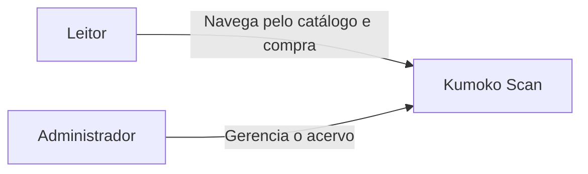
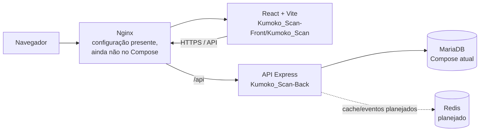
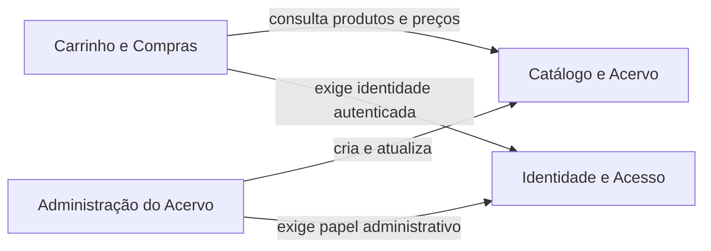

# Arquitetura inicial

> Estado: proposta inicial baseada no código e no Compose atualmente presentes na
> raiz. Validar os limites de domínio e a API ativa antes de refatorar ou migrar dados.

## C4 — Contexto

O sistema oferece catálogo e compras para leitores e gestão do acervo para
administradores. Os usuários acessam pelo navegador. A interface e a API são
componentes distintos; a autorização é responsabilidade da API.

## C4 — Containers

O diagrama representa o alvo de organização, não o estado de execução atual. Hoje,
o Compose da raiz sobe somente `database` e `backend`; Nginx e frontend não estão
declarados nele. Redis ainda não está configurado. Corrigir nomes de serviço,
healthchecks, rede, TLS e dependências em uma mudança própria, após confirmar qual
API será mantida.

## Estilo arquitetural

Adotar um **monólito modular** como ponto de partida. Organizar módulos por domínio
e manter dependências explícitas; executar como uma API até que requisitos medidos
justifiquem separar processos. Isso mantém transações e operação simples sem impedir
que um módulo evolua no futuro.

## Context Map proposto

Os contextos são limites conceituais dentro do monólito, não serviços implantados
separadamente. Não compartilhar modelos de persistência entre contextos como API
pública; integrar por contratos de aplicação. A relação com catálogo e carrinho
deve ser refinada quando as regras de compra forem validadas.

## Domínio de Compras — modelo inicial

### Aggregate `Compra`

- **Aggregate root / Entity:** `Compra`, identificada por ID, usuário, estado,
  data e itens.
- **Entity:** `ItemCompra`, com referência ao produto e quantidade. O preço
  registrado deve ser um snapshot no momento da compra, não um valor recalculado
  posteriormente a partir do catálogo.
- **Value Objects:** `Dinheiro` (valor e moeda), `ReferenciaProduto` (tipo e ID)
  e `StatusCompra`.
- **Invariantes propostas:** compra exige usuário e ao menos um item; quantidade
  positiva; total calculado a partir dos itens; transições de estado explícitas.
- **Consistência:** validar preço e disponibilidade no servidor no fechamento.
  Uma operação de compra não pode confiar em total enviado pelo navegador.

Esse é um modelo-alvo para discussão e não afirma que o modelo Sequelize atual já
implementa o aggregate ou essas invariantes.
