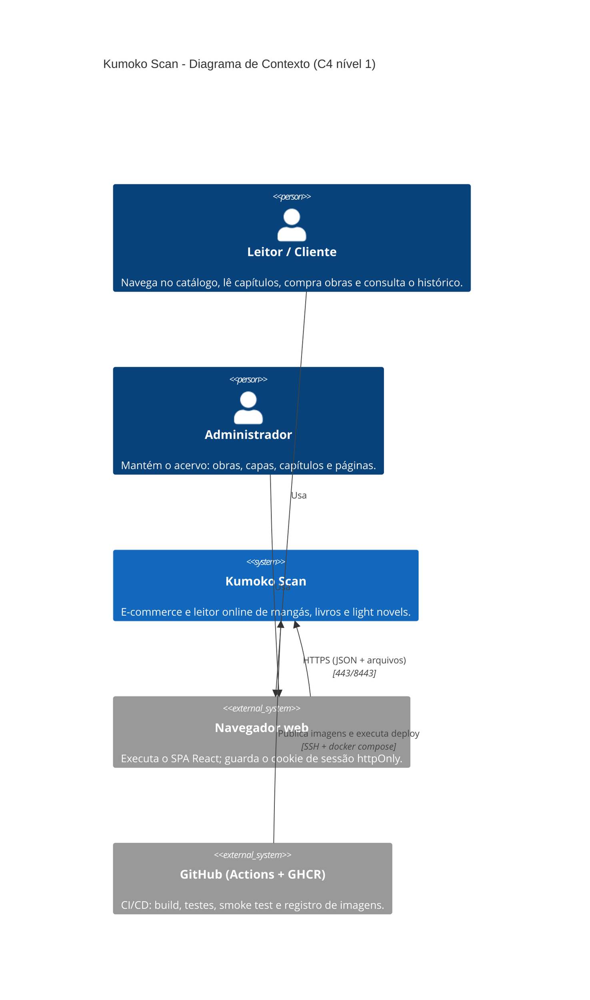
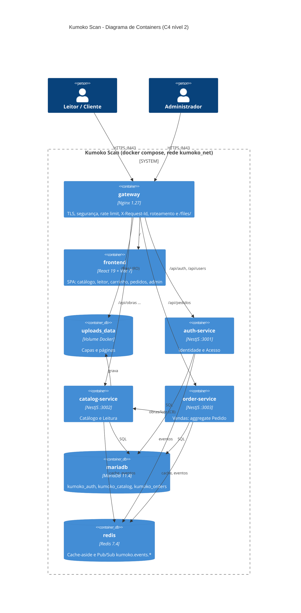
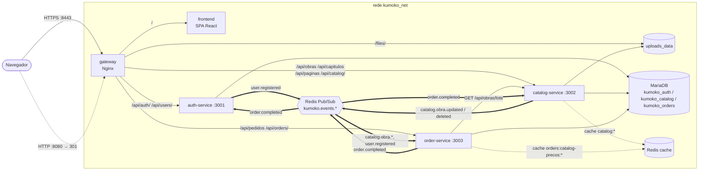
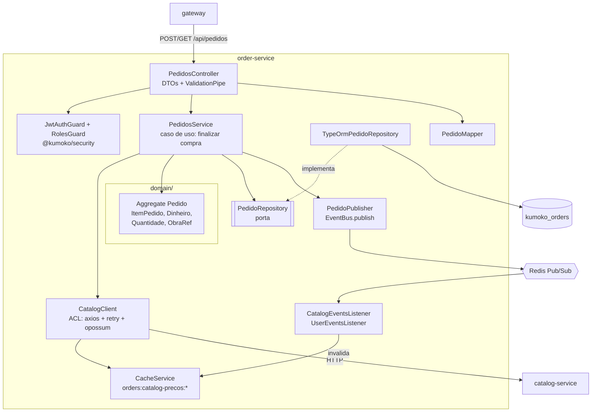
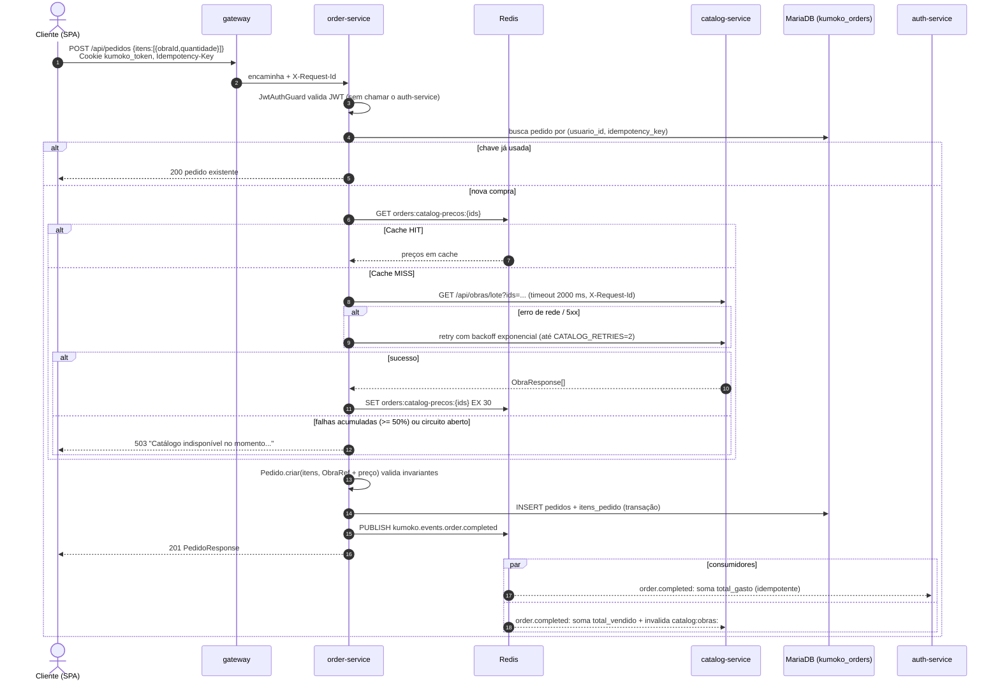

# Modelo C4 — Kumoko Scan

Diagramas do modelo C4 (Simon Brown) para a versão 1.0.0 (microsserviços). Os nomes
de serviços, portas e rotas seguem o `docker-compose.yml` e o contrato em
[`../api/openapi.yaml`](../api/openapi.yaml).

- Nível 1 — Contexto: quem usa o sistema e com o que ele conversa.
- Nível 2 — Containers: unidades executáveis (cada uma é um serviço do Compose).
- Nível 3 — Componentes do `order-service` (contexto com modelagem de domínio mais rica).
- Visão dinâmica — checkout com retry, circuit breaker e eventos.

## Nível 1 — Contexto

Fora do escopo (decisão consciente): não há gateway de pagamento nem envio de e-mail.
O pedido é registrado já como `CONCLUIDO` (pagamento simulado). Ver backlog
([`../gestao/backlog.md`](../gestao/backlog.md)) para a evolução prevista.

## Nível 2 — Containers

### Vista equivalente em flowchart (rotas e eventos)

O renderizador C4 do Mermaid posiciona os elementos automaticamente; a vista abaixo
mostra a mesma topologia com as rotas do gateway e os canais de eventos lado a lado.

| Container | Tecnologia | Porta | Exposto no host | Responsabilidade |
|---|---|---|---|---|
| `gateway` | Nginx 1.27 | 80, 443 | 8080, 8443 | Única porta de entrada: TLS, segurança, rate limit, roteamento |
| `frontend` | nginx:alpine + build Vite | 80 | não | SPA React |
| `auth-service` | NestJS | 3001 | não | Identidade e Acesso |
| `catalog-service` | NestJS | 3002 | não | Catálogo e Leitura (+ gestão do acervo) |
| `order-service` | NestJS | 3003 | não | Vendas / Pedidos |
| `mariadb` | MariaDB 11.4 | 3306 | não | Persistência (database por serviço) |
| `redis` | Redis 7.4 | 6379 | não | Cache distribuído e mensageria |

## Nível 3 — Componentes do order-service

## Visão dinâmica — checkout (`POST /api/pedidos`)

Obras inexistentes retornam 422 com a lista de ids; o preço enviado pelo cliente é
ignorado porque o DTO só aceita `obraId` e `quantidade`. Detalhes de cada estratégia
estão em [`../operacao/resiliencia.md`](../operacao/resiliencia.md).
