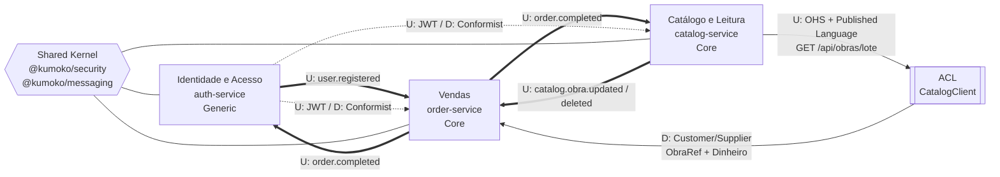
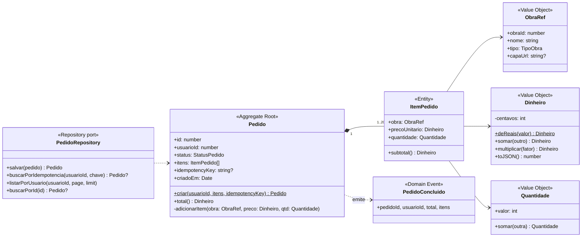

# Domain-Driven Design — Kumoko Scan

Este documento descreve o domínio, os subdomínios, os Bounded Contexts e como eles se
relacionam (Context Map). Também lista Entities, Value Objects e Aggregates dos
contextos de **Vendas** (modelagem rica, implementada em `order-service`) e
**Catálogo e Leitura**.

## 1. Domínio

**Comercialização e leitura online de mangás, livros e light novels.** O negócio
centraliza um acervo de publicações (antes divulgado de forma descentralizada), deixa o
leitor ler capítulos online e vende as obras. O administrador mantém o acervo.

## 2. Subdomínios

| Subdomínio | Tipo | Por quê | Onde vive |
|---|---|---|---|
| **Catálogo e Leitura** | Core | É o diferencial do produto: acervo organizado por tipo, busca, mais vendidos e leitor de capítulos. Sem ele não há razão para o cliente vir ao site. | `catalog-service` |
| **Vendas (Pedidos)** | Core | Gera a receita; concentra as regras mais sensíveis (preço confiável, totais exatos, idempotência). Foi onde o legado tinha o bug mais grave (preço vindo do cliente). | `order-service` |
| **Gestão do Acervo** | Supporting | Necessário para o core funcionar (cadastro de obras, capítulos, páginas, capas), mas não diferencia o negócio. | `catalog-service` (rotas admin) |
| **Identidade e Acesso** | Generic | Cadastro, login, papéis. Problema resolvido pelo mercado; implementado de forma simples com JWT. | `auth-service` |
| **Armazenamento de mídia** | Generic | Guardar e servir imagens. | volume `uploads_data` + gateway `/files/` |
| **Pagamento** | Generic (fora do escopo) | Seria integrado a um provedor; hoje o pedido nasce `CONCLUIDO` (pagamento simulado). | não implementado |
| **Carrinho** | Supporting | Estado temporário do cliente antes do pedido; sem regra de negócio no servidor. | frontend (`CartContext`, `localStorage`) |

## 3. Bounded Contexts

### 3.1 Identidade e Acesso (`auth-service`, database `kumoko_auth`)

- **Responsabilidade:** cadastrar clientes, autenticar, emitir JWT, manter perfil e o
  total gasto do usuário.
- **Linguagem ubíqua:** *Usuário*, *Credenciais*, *Papel* (`admin`/`customer`), *Sessão*
  (cookie `kumoko_token`), *Total gasto*.
- **Regras:** e-mail e CPF únicos; CPF com dígitos verificadores válidos; senha forte;
  cadastro público nunca cria admin; admin provisionado por `ADMIN_*`.
- **Publica:** `user.registered`. **Consome:** `order.completed` (soma `total_gasto`).

### 3.2 Catálogo e Leitura (`catalog-service`, database `kumoko_catalog`)

- **Responsabilidade:** acervo de obras (mangá, livro, novel), capítulos, páginas,
  capas e arquivos; listagens com filtro, busca, ordenação e cache.
- **Linguagem ubíqua:** *Obra*, *Tipo* (mangá/livro/novel), *Capa*, *Capítulo*,
  *Página*, *Leitor*, *Mais vendidos* (`totalVendido`).
- **Regras:** número de capítulo único por obra (aceita 10.5); número de página único
  por capítulo; excluir obra apaga capítulos, páginas e arquivos; imagem validada por
  assinatura (magic bytes).
- **Publica:** `catalog.obra.updated`, `catalog.obra.deleted`.
  **Consome:** `order.completed` (soma `total_vendido`, invalida cache).
- **Open Host Service:** `GET /api/obras/lote?ids=` para outros contextos.

### 3.3 Vendas / Pedidos (`order-service`, database `kumoko_orders`)

- **Responsabilidade:** transformar o carrinho em pedido com preço confiável, garantir
  invariantes do pedido, idempotência e histórico do cliente.
- **Linguagem ubíqua:** *Pedido*, *Item do pedido*, *Preço unitário* (snapshot),
  *Subtotal*, *Total*, *Chave de idempotência*, *Pedido concluído*.
- Aqui "obra" é apenas uma **referência** (`ObraRef`: id, nome, tipo, capa) congelada no
  momento da compra. O modelo de Obra do Catálogo não entra neste contexto.
- **Publica:** `order.completed`. **Consome:** `catalog.obra.updated/deleted` (invalida
  cache de preços) e `user.registered` (apenas log de auditoria).

### Mesma palavra, significados diferentes

| Termo | Identidade | Catálogo | Vendas |
|---|---|---|---|
| Usuário | Agregado com credenciais e papel | (não existe) | Apenas `usuarioId` do token (o "cliente" do pedido) |
| Obra | (não existe) | Agregado editável, com preço atual, capítulos e capa | `ObraRef` imutável + preço pago congelado |
| Preço | — | Valor atual de venda (`obras.preco`) | `precoUnitario` do item no instante da compra |

## 4. Context Map

Legenda: **U** = upstream, **D** = downstream. Setas sólidas = integração síncrona
HTTP; setas grossas = eventos Redis Pub/Sub; pontilhadas = conformidade com o token.

| Relação | Padrão | Justificativa |
|---|---|---|
| Catálogo → Vendas | **Customer/Supplier** com **Open Host Service** + **Published Language** no upstream e **Anticorruption Layer** no downstream | Vendas precisa de preço e nome confiáveis; o `CatalogClient` traduz `ObraResponse` para `ObraRef` + `Dinheiro`, isolando o domínio de Vendas de mudanças no JSON do catálogo. |
| Vendas → Identidade, Vendas → Catálogo | **Published Language** (evento `order.completed`) | Vendas não conhece as tabelas dos outros; cada consumidor decide o efeito (somar `total_gasto`, somar `total_vendido`). |
| Catálogo → Vendas | **Published Language** (`catalog.obra.*`) | Mantém o cache de preços do downstream coerente sem acoplamento síncrono. |
| Identidade → Catálogo e Vendas | **Conformist** | Os demais aceitam o formato do JWT emitido pela Identidade sem tradução. |
| Libs `@kumoko/security` e `@kumoko/messaging` | **Shared Kernel** (pequeno e controlado) | Contratos de token e de eventos compartilhados em tempo de compilação. Regra: o kernel não contém regra de negócio. |
| Frontend → serviços | Cliente dos Open Host Services via gateway | Contrato em [`../api/openapi.yaml`](../api/openapi.yaml). |

## 5. Modelo tático — Vendas (`order-service`)

Código em `backend/apps/order-service/src/modules/pedidos/domain/`.

### Aggregate

| Elemento | Tipo | Identidade / igualdade | Invariantes e comportamento |
|---|---|---|---|
| `Pedido` | **Aggregate Root** | Por `id` | Pelo menos 1 item; no máximo 20 obras distintas; itens da mesma obra são **somados** em um único item; `total = Σ subtotal`; `status` inicia em `CONCLUIDO` (pagamento simulado); só pode ser criado com preços vindos do catálogo (via ACL), nunca do cliente. Toda alteração passa pela raiz. |

### Entities

| Entity | Identidade | Observações |
|---|---|---|
| `ItemPedido` | Pela obra dentro do pedido (`obraId`) e `id` na persistência | Só existe dentro de `Pedido`; `subtotal = precoUnitario × quantidade`. |
| `Pedido` | `id` | Também é a raiz do aggregate. |

### Value Objects

| Value Object | Regras | Por que VO |
|---|---|---|
| `Dinheiro` | Centavos inteiros (evita erro de ponto flutuante); não negativo; `somar`, `multiplicar`; serializa como número com 2 casas | Igualdade por valor; imutável |
| `Quantidade` | Inteiro de 1 a 99; somar duas quantidades revalida o limite | Concentra a regra de limite |
| `ObraRef` | `obraId`, `nome`, `tipo`, `capaUrl` congelados no momento da compra | Snapshot imutável do catálogo, sem FK entre bancos |
| `StatusPedido` | `CONCLUIDO` ou `CANCELADO` | Enum de domínio |
| `IdempotencyKey` (string ≤ 64) | Única por usuário | Evita pedido duplicado em retry/duplo clique |

### Domain Events

| Evento de domínio | Evento de integração | Consumidores |
|---|---|---|
| `PedidoConcluido` | `order.completed` (`OrderCompletedPayload { pedidoId, usuarioId, total, itens[] }`) | auth-service (`total_gasto`), catalog-service (`total_vendido`) |

### Serviços e portas

- **Application Service** `PedidosService.finalizar(usuarioId, dto, idempotencyKey)`:
  checa idempotência → obtém preços via `CatalogClient` → `Pedido.criar(...)` →
  `PedidoRepository.salvar` (transação) → publica `order.completed`.
- **Repository port** `PedidoRepository` com implementação TypeORM (mapeia
  `pedidos`/`itens_pedido` ↔ aggregate).
- **Anticorruption Layer** `CatalogClient` (`modules/catalogo/catalog.client.ts`):
  única peça que conhece o JSON do catálogo; aplica timeout, retry, circuit breaker e
  cache de preços.
- **Erros de domínio** → HTTP: invariante violada → 400/422; obra inexistente → 422
  com a lista de ids; catálogo indisponível → 503.

## 6. Modelo tático — Catálogo e Leitura (`catalog-service`)

O catálogo é majoritariamente CRUD com regras de integridade garantidas pelo banco;
a implementação usa entidades TypeORM e services (modelo propositalmente mais simples
que o de Vendas). Conceitualmente:

| Elemento | Tipo | Regras |
|---|---|---|
| `Obra` | **Aggregate Root** | `tipo` ∈ {manga, livro, novel}; `preco ≥ 0`; `avaliacao` 0..5; possui no máximo uma capa; ao ser excluída remove capítulos, páginas e arquivos; mudança publica `catalog.obra.updated/deleted`. |
| `Capitulo` | **Aggregate Root** separado (referencia `obraId`) | `numero` decimal único por obra; carregado sob demanda pelo leitor (uma obra pode ter centenas de capítulos, por isso não fica dentro do aggregate `Obra`). |
| `Pagina` | **Entity** dentro do aggregate `Capitulo` | `numero` único no capítulo; sem número informado, vira a próxima; imagem validada por magic bytes. |
| `TipoObra` | Value Object | Enum `manga`, `livro`, `novel` (substitui as três tabelas do legado). |
| `Preco` | Value Object | Decimal ≥ 0 com 2 casas. |
| `Avaliacao` | Value Object | 0.0 a 5.0, padrão 5.0. |
| `CaminhoArquivo` | Value Object | Caminho relativo seguro (`covers/<uuid>.jpg`, `pages/obra_<id>/capitulo_<id>/<uuid>.jpg`) convertido em URL pública `/files/...`. |
| `TotalVendido` | Atributo derivado | Atualizado apenas pelo evento `order.completed` (idempotente via `eventos_processados`). |

## 7. Modelo tático — Identidade e Acesso (resumo)

- Aggregate `Usuario` (raiz) com Value Objects `Email` (normalizado em minúsculas),
  `Cpf` (11 dígitos com dígitos verificadores), `SenhaHash` (bcryptjs custo 12) e
  `Role` (`admin` | `customer`).
- `TotalGasto` é atributo derivado, atualizado por `order.completed`.
- Domain event `UsuarioRegistrado` → evento de integração `user.registered`.
