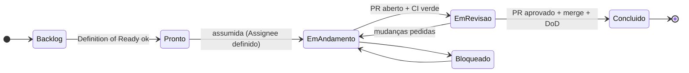

# Gestão do projeto no Jira

Projeto Jira **Kumoko Scan**, chave **`KUM`**, tipo *Scrum* (software, company-managed)
com board que também mostra limites de WIP (Scrumban — ver [cynefin.md](./cynefin.md)).

## 1. Tipos de issue

| Tipo | Uso | Exemplo |
|---|---|---|
| **Epic** | Agrupa uma capacidade de negócio ou de plataforma (um por épico do backlog) | EP-3 Vendas |
| **Story** | Valor para uma persona, formato "Como... quero... para..." + critérios Gherkin | [US-14] Finalizar compra com preço do catálogo |
| **Task** | Trabalho técnico necessário que não é valor direto para o usuário | CatalogClient com timeout, retry e circuit breaker |
| **Sub-task** | Quebra de uma story/task em passos de até 1 dia | "DTO + validação", "testes", "Swagger" |
| **Bug** | Comportamento incorreto; inclui incidentes (label `incidente`) | Compra gravava preço enviado pelo cliente |

Campos usados: Prioridade (Highest → Lowest), Story Points (Fibonacci), Labels
(`auth`, `catalogo`, `pedidos`, `acervo`, `frontend`, `infra`, `cache`, `mensageria`,
`resiliencia`, `observabilidade`, `seguranca`, `testes`, `docs`, `ci-cd`), Sprint,
Fix Version (SemVer, ex.: `v1.0.0`), Responsável (Assignee) e Componentes
(`auth-service`, `catalog-service`, `order-service`, `frontend`, `gateway`).

## 2. Workflow

| Status (coluna) | Política | WIP |
|---|---|---|
| Backlog | Priorizado pelo Product Owner | — |
| Pronto | Atende à Definition of Ready (história clara, Gherkin, estimada) | — |
| Em andamento | Tem responsável e branch | 2 por pessoa |
| Bloqueado | Comentário dizendo o bloqueio e issue vinculada | — |
| Em revisão | PR aberto, CI verde (backend, frontend, compose-smoke) | 3 no time |
| Concluído | Definition of Done atendida | — |

Bugs `Highest` (SEV1) usam uma **raia de expedição** no topo do board e podem furar o
WIP. Atribuição: cada issue tem um único responsável; o responsável move o card.

## 3. Convenções de Git ligadas ao Jira

- **Branch:** `<tipo>/KUM-<n>-<descricao-curta>` — ex.: `feature/KUM-114-checkout-preco-servidor`,
  `fix/KUM-301-admin-por-email`.
- **Commit (Conventional Commits + chave):**
  `feat(order): calcula total no aggregate Pedido KUM-114`,
  `fix(auth): remove fallback do segredo JWT KUM-302`,
  `docs: adiciona ADR-003 KUM-212`.
- **PR:** título com a chave (`KUM-114 Checkout com preço do catálogo`), descrição com o
  link da issue e checklist da DoD. Com a integração GitHub ↔ Jira, branch, commits e PR
  aparecem no painel "Development" da issue e o card pode andar sozinho (smart commits:
  `KUM-114 #comment ...`, `KUM-114 #done`).
- **Release:** a Fix Version do Jira tem o mesmo nome da tag Git (`v1.0.0`); as notas de
  release do Jira alimentam o [`CHANGELOG.md`](../../CHANGELOG.md).

## 4. Importação do backlog (CSV)

Arquivo: [`jira-import.csv`](./jira-import.csv) — 90 issues: 6 épicos, 47 stories, 19 tasks e
18 bugs (bugs reais do código legado e os encontrados na auditoria da Sprint 7).

Colunas: `Issue Id, Summary, Issue Type, Priority, Description, Parent, Epic Name,
Labels, Story Points, Sprint, Status, Assignee`.

Passo a passo (Jira Cloud → *Configurações do sistema → Importação externa → CSV*):

1. Selecionar o projeto `KUM`, codificação UTF-8, separador vírgula.
2. Mapear colunas:
   - `Issue Id` → **Issue Id** (identificador interno do arquivo, usado para os vínculos);
   - `Parent` → **Parent Id** (liga story/task/bug ao épico pelo `Issue Id` do épico);
   - `Epic Name` → **Epic Name** (só preenchido nos épicos; necessário em projetos company-managed);
   - `Story Points` → **Story point estimate**;
   - `Sprint` → **Sprint** (criar antes as sprints "KUM Sprint 5", "KUM Sprint 6" e "KUM Sprint 7", ou deixar sem mapear);
   - `Status` → mapear valores: `Backlog`, `Em andamento`, `Em revisão`, `Concluído` para os status do workflow;
   - `Assignee` → vazio de propósito: os responsáveis são definidos na planning.
3. Validar a pré-visualização e importar.

O resumo das stories começa com `[US-xx]`, o mesmo identificador usado em
[`backlog.md`](./backlog.md), onde estão os critérios de aceite completos.

## 5. Relatórios acompanhados

- **Burndown da sprint** e **velocity** (média de story points concluídos por sprint)
  para planejar a próxima.
- **Cumulative Flow Diagram** para ver gargalos (acúmulo em "Em revisão").
- **Release burnup** por Fix Version (`v1.0.0`, `v1.1.0`...).
- Filtro de bugs abertos por prioridade e label `incidente` (insumo do post-mortem —
  ver [runbook](../operacao/runbook.md#9-encerramento-e-pós-incidente)).
