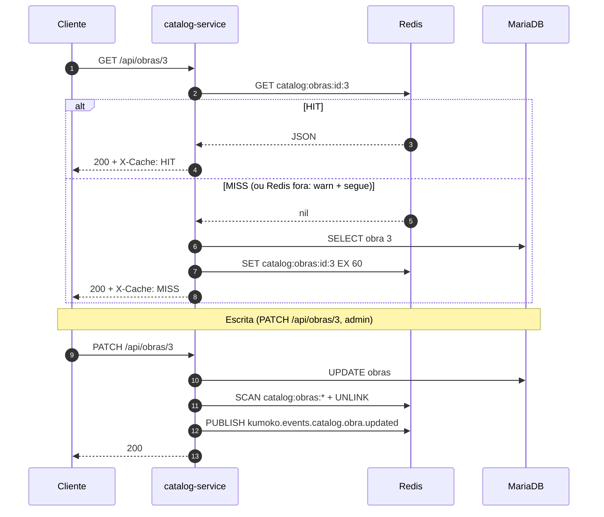

# Cache distribuído e mensageria (Redis)

Como funcionam e **como demonstrar** o cache-aside com TTL e invalidação e a
circulação de eventos via Redis Pub/Sub. Decisão registrada em
[ADR-003](../arquitetura/adr/ADR-003-redis-cache-e-pubsub.md).

Pré-requisito: stack no ar (`docker compose up -d --build --wait`) e, no shell do host,
a senha do Redis carregada a partir do `.env`:

```bash
export $(grep -E '^(REDIS_PASSWORD|ADMIN_EMAIL|ADMIN_PASSWORD|CACHE_TTL_SECONDS)=' .env | xargs)
alias rcli='docker compose exec -T redis redis-cli -a "$REDIS_PASSWORD" --no-auth-warning'
BASE=https://localhost:8443
```

`-k` nos comandos `curl` aceita o certificado autoassinado do ambiente local.

## 1. Cache-aside



### Chaves, TTL e invalidação

| Chave | TTL | Invalidada por |
|---|---|---|
| `catalog:obras:list:<hash-dos-filtros>` | `CACHE_TTL_SECONDS` (60) | criar/editar/excluir obra; `order.completed` |
| `catalog:obras:id:<id>` | 60 | idem |
| `catalog:obras:capitulos:<obraId>` | 60 | criar/editar/excluir capítulo ou página da obra |
| `catalog:capitulos:paginas:<capituloId>` | 60 | enviar/excluir página do capítulo |
| `orders:catalog-precos:<ids-ordenados>` | 30 | eventos `catalog.obra.updated` / `catalog.obra.deleted` |

### Demonstração automática

```bash
bash scripts/demo-cache.sh
```

O script executa a sequência abaixo e imprime o header `X-Cache` de cada passo.

### Demonstração manual (passo a passo)

```bash
# 1) Primeira leitura: MISS (vai ao banco e grava no Redis)
curl -sk -D - -o /dev/null "$BASE/api/obras/1" | grep -i x-cache      # X-Cache: MISS

# 2) Segunda leitura: HIT
curl -sk -D - -o /dev/null "$BASE/api/obras/1" | grep -i x-cache      # X-Cache: HIT

# 3) A chave e o TTL no Redis
rcli --scan --pattern 'catalog:*'
rcli TTL catalog:obras:id:1                                           # <= 60

# 4) Invalidação em update: login como admin e PATCH
TOKEN=$(curl -sk "$BASE/api/auth/login" -H 'Content-Type: application/json' \
  -d "{\"email\":\"$ADMIN_EMAIL\",\"senha\":\"$ADMIN_PASSWORD\"}" | sed -E 's/.*"accessToken":"([^"]+)".*/\1/')
curl -sk -X PATCH "$BASE/api/obras/1" -H "Authorization: Bearer $TOKEN" -F preco=34.90 -o /dev/null -w '%{http_code}\n'
rcli EXISTS catalog:obras:id:1                                        # 0 (removida)

# 5) Próxima leitura volta a ser MISS e já traz o preço novo
curl -sk -D - "$BASE/api/obras/1" | grep -iE 'x-cache|"preco"'

# 6) Expiração por TTL: sem escrita, a chave some sozinha após CACHE_TTL_SECONDS
sleep "${CACHE_TTL_SECONDS:-60}"; rcli EXISTS catalog:obras:id:1      # 0
```

Logs esperados no `catalog-service` (`docker compose logs -f catalog-service | grep Cache`):

```text
Cache MISS key=catalog:obras:id:1 ttl=60
Cache HIT key=catalog:obras:id:1
Cache INVALIDATE prefix=catalog:obras: removidas=3
Cache MISS key=catalog:obras:id:1 ttl=60
```

### Falha do Redis (fallback)

```bash
docker compose stop redis
curl -sk -o /dev/null -w '%{http_code}\n' "$BASE/api/obras"   # 200, servido pelo banco
docker compose logs --since 1m catalog-service | grep -i warn  # aviso de cache indisponível
docker compose start redis
```

## 2. Mensageria (Redis Pub/Sub)

### Eventos

| Tipo | Canal | Publicador | Consumidores e efeito |
|---|---|---|---|
| `order.completed` | `kumoko.events.order.completed` | order-service | auth: soma `total` em `usuarios.total_gasto`; catalog: soma `quantidade` em `obras.total_vendido` e invalida `catalog:obras:` (ambos idempotentes por `eventos_processados`) |
| `catalog.obra.updated` | `kumoko.events.catalog.obra.updated` | catalog-service | order: invalida `orders:catalog-precos:` |
| `catalog.obra.deleted` | `kumoko.events.catalog.obra.deleted` | catalog-service | order: invalida `orders:catalog-precos:` |
| `user.registered` | `kumoko.events.user.registered` | auth-service | order: log de auditoria |

Envelope publicado (JSON):

```json
{
  "id": "0d8f1c9a-5b4e-4f3a-9c2d-7e6b5a4f3c21",
  "type": "order.completed",
  "source": "order-service",
  "occurredAt": "2026-11-14T13:05:00.120Z",
  "correlationId": "9a7d0b1e-2c55-4f8e-8f0e-2b1c3d4e5f60",
  "payload": {
    "pedidoId": 12,
    "usuarioId": 7,
    "total": 89.7,
    "itens": [
      { "obraId": 3, "quantidade": 2, "precoUnitario": 29.9 },
      { "obraId": 5, "quantidade": 1, "precoUnitario": 29.9 }
    ]
  }
}
```

### Demonstração automática

```bash
bash scripts/demo-events.sh
```

O script cria/autentica um cliente, finaliza um pedido e mostra os logs de publicação e
consumo nos três serviços, além do `totalGasto` atualizado em `GET /api/users/me`.

### Demonstração manual

Terminal 1 — "escutar o barramento" direto no Redis:

```bash
rcli PSUBSCRIBE 'kumoko.events.*'
```

Terminal 2 — logs dos serviços:

```bash
docker compose logs -f auth-service catalog-service order-service \
  | grep -E 'Evento (publicado|recebido|processado)|Falha ao processar'
```

Terminal 3 — gerar eventos:

```bash
# cliente novo (gera user.registered)
curl -sk "$BASE/api/auth/register" -H 'Content-Type: application/json' \
  -d '{"nome":"Demo","email":"demo@exemplo.com","cpf":"11144477735","senha":"Demo12345"}'
CTOKEN=$(curl -sk "$BASE/api/auth/login" -H 'Content-Type: application/json' \
  -d '{"email":"demo@exemplo.com","senha":"Demo12345"}' | sed -E 's/.*"accessToken":"([^"]+)".*/\1/')

# pedido (gera order.completed)
curl -sk "$BASE/api/pedidos" -H "Authorization: Bearer $CTOKEN" -H 'Content-Type: application/json' \
  -H "Idempotency-Key: demo-$(date +%s)" -d '{"itens":[{"obraId":1,"quantidade":2}]}'

# efeitos dos consumidores
curl -sk "$BASE/api/users/me" -H "Authorization: Bearer $CTOKEN"   # totalGasto atualizado
curl -sk "$BASE/api/obras/1" | grep -o '"totalVendido":[0-9]*'      # totalVendido somado

# alteração de obra pelo admin (gera catalog.obra.updated)
curl -sk -X PATCH "$BASE/api/obras/1" -H "Authorization: Bearer $TOKEN" -F avaliacao=4.8 -o /dev/null
```

Logs esperados (mesmo `id` e `correlationId` em todos):

```text
order-service    Evento publicado type=order.completed id=0d8f... channel=kumoko.events.order.completed source=order-service
auth-service     Evento recebido type=order.completed id=0d8f... source=order-service correlationId=9a7d...
auth-service     Evento processado type=order.completed id=0d8f...
catalog-service  Evento recebido type=order.completed id=0d8f... source=order-service correlationId=9a7d...
catalog-service  Cache INVALIDATE prefix=catalog:obras: removidas=N
catalog-service  Evento processado type=order.completed id=0d8f...
catalog-service  Evento publicado type=catalog.obra.updated id=... channel=kumoko.events.catalog.obra.updated source=catalog-service
order-service    Evento recebido type=catalog.obra.updated ...
order-service    Cache INVALIDATE prefix=orders:catalog-precos: removidas=N
```

### Idempotência do consumidor

Reenviar manualmente o mesmo envelope (mesmo `id`) não soma de novo:

```bash
rcli PUBLISH kumoko.events.order.completed '<envelope com id já processado>'
# log esperado: evento ignorado por já ter sido processado; total_gasto inalterado
```

### Limitação

Pub/Sub entrega só para quem está conectado no momento (at-most-once). Para ver isso:
`docker compose stop auth-service`, faça um pedido e suba o serviço de novo — o
`total_gasto` daquele pedido não é somado. Esse comportamento é aceito e documentado
em [`resiliencia.md`](./resiliencia.md#limitações-conhecidas-aceitas-na-v100).
