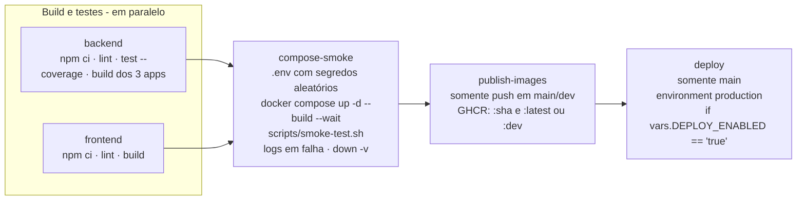

# Pipeline CI/CD e estratégia de deploy

## 1. Pipeline (`.github/workflows/ci.yml`)

Disparo: `push` em `main` e `dev`, e todo pull request.



| Job | Garante | Falha quando |
|---|---|---|
| `backend` | Lint, testes unitários com cobertura e build de `auth-service`, `catalog-service`, `order-service` | Erro de lint/tipagem, teste quebrado |
| `frontend` | Lint e build de produção do SPA | Erro de build, regra do eslint |
| `compose-smoke` | Stack completa sobe saudável e o fluxo crítico funciona (login, catálogo, checkout, eventos) | Healthcheck não fica verde, smoke test falha |
| `publish-images` | Depois do smoke test, imagens imutáveis por commit de `gateway`, `frontend`, `auth-service`, `catalog-service` e `order-service` em `ghcr.io/<owner>/<repo>/<serviço>:<sha>`, mais a tag móvel `:latest` (main) ou `:dev` (dev) | Falha de build/push |
| `deploy` | Esqueleto: SSH no servidor, `IMAGE_REGISTRY` e `IMAGE_TAG=<sha>`, `docker compose pull && docker compose up -d --no-build --wait` | Desabilitado por padrão (`DEPLOY_ENABLED`) |

O job `deploy` é um **esqueleto**: não há servidor de produção configurado. Para ativá-lo
são necessários a variável `DEPLOY_ENABLED=true` e os secrets `DEPLOY_HOST`,
`DEPLOY_USER`, `DEPLOY_SSH_KEY`, `DEPLOY_KNOWN_HOSTS` e `DEPLOY_PATH` (pasta no servidor
com `docker-compose.yml`, `.env` e `infra/`) no environment `production`.

## 2. Estratégia adotada: rolling com healthcheck + rollback por tag

Para um host único com Docker Compose, a estratégia mais simples e segura é:

1. **Imagens imutáveis por commit** (`:sha`). `latest` é só conveniência; o deploy
   registra qual `sha` está em produção.
2. **Atualização serviço a serviço** com `docker compose up -d --wait`: o Compose
   recria apenas os containers cuja imagem mudou e aguarda os healthchecks. Se algum
   não ficar `healthy`, o comando falha e o pipeline para.
3. **Migrations forward-only** rodam no boot do serviço (`migrationsRun: true`). Toda
   migration precisa ser **compatível com a versão anterior** do código (padrão
   expand/contract): primeiro adicionar colunas/tabelas, só remover em uma versão
   posterior. Isso é o que torna o rollback de imagem seguro.
4. **Verificação pós-deploy:** `scripts/smoke-test.sh` apontando para o ambiente.

Janela de indisponibilidade esperada: segundos por serviço (um container por serviço;
o gateway devolve 502 enquanto o upstream reinicia — GETs são repetidos pelo
`proxy_next_upstream`).

### Rollback

Gatilhos: smoke test falhou, taxa de 5xx acima do SLO após o deploy, container
`unhealthy` ou reiniciando.

```bash
# no servidor, voltando os serviços para o sha anterior conhecido como bom
export IMAGE_REGISTRY=ghcr.io/<owner>/<repo> IMAGE_TAG=<sha-anterior>
docker compose pull
docker compose up -d --no-build --wait
bash scripts/smoke-test.sh
```

O `docker-compose.yml` já declara `image: ${IMAGE_REGISTRY:-kumoko-scan}/<serviço>:${IMAGE_TAG:-latest}`
para os serviços construídos: em desenvolvimento ele faz build local; no servidor,
`--no-build` com `IMAGE_REGISTRY`/`IMAGE_TAG` usa as imagens publicadas. Alternativa
equivalente: reexecutar (Re-run) o job `deploy` de um run anterior bem-sucedido.

Regras de rollback:

- **Nunca** rodar migration "down" automaticamente; dados novos poderiam ser perdidos.
  Graças ao expand/contract, o código anterior funciona com o schema novo.
- **Nunca** usar `docker compose down -v` em produção (apaga `db_data`, `redis_data`,
  `uploads_data`).
- Antes de deploy com migration, fazer backup:
  `docker compose exec mariadb sh -c 'mariadb-dump -uroot -p"$MARIADB_ROOT_PASSWORD" --all-databases' > backup-$(date +%F).sql`.
- Registrar o rollback como incidente no Jira e seguir o [runbook](./runbook.md).

## 3. Evolução: blue/green

Quando houver mais de um host ou necessidade de deploy sem 502:

1. Subir a versão nova como projeto Compose paralelo (`-p kumoko-green`) na mesma rede,
   sem publicar portas.
2. Rodar o smoke test contra o green pela rede interna.
3. Trocar os `upstream` do gateway para os containers green e `nginx -s reload`
   (sem derrubar conexões).
4. Manter o blue parado por um período; rollback = apontar o upstream de volta.

Restrições: banco e Redis são compartilhados entre blue e green, por isso o
expand/contract nas migrations continua obrigatório.

## 4. Versionamento das entregas

Tags SemVer no Git (`vMAJOR.MINOR.PATCH`) marcam releases; o
[`CHANGELOG.md`](../../CHANGELOG.md) registra o conteúdo de cada versão. Convenções em
[`../gestao/backlog.md`](../gestao/backlog.md#6-versionamento-e-lançamentos-parciais).
