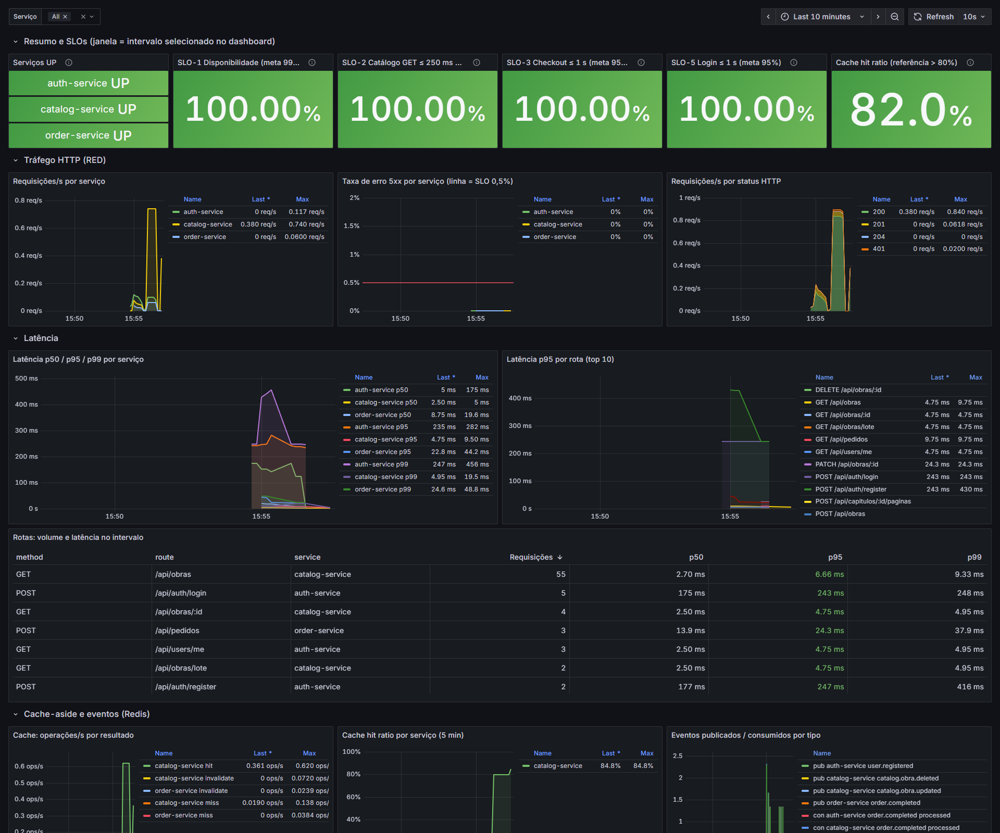

# Plano de observabilidade

Objetivo: conseguir responder, só com o que o sistema emite, a três perguntas — **está
funcionando?** (métricas e healthchecks), **o que aconteceu com esta requisição?**
(logs correlacionados) e **onde está o gargalo?** (latência por serviço e rota).

## 1. Pilares implementados

| Pilar | Implementação | Onde ver |
|---|---|---|
| Logs estruturados | `nestjs-pino` em JSON (`@kumoko/observability`); log de acesso JSON no Nginx | `docker compose logs <serviço>` |
| Correlação | `X-Request-Id` gerado/propagado pelo gateway; `genReqId` reaproveita o header; repassado ao catálogo pelo `CatalogClient`; vira `correlationId` no envelope dos eventos; aparece no corpo de todo erro (`requestId`) | Logs de todos os containers |
| Métricas | `prom-client`: métricas padrão do processo, histograma `http_request_duration_seconds{method,route,status_code,service}`, `cache_operations_total`, `events_published_total`, `events_consumed_total`, `circuit_breaker_state` | Prometheus (coleta interna) + Grafana em https://localhost:8443/grafana/ |
| Saúde | `GET /health` (terminus: banco e Redis), `/nginx-health` no gateway; healthchecks no Compose | `docker compose ps` |
| Rastreamento distribuído | **Não implementado** (OpenTelemetry é evolução); a correlação por `X-Request-Id` cobre o caso de uso principal | — |

## 2. Logs

### Campos

| Campo | Exemplo | Origem |
|---|---|---|
| `level` | `30` (info), `40` (warn), `50` (error) | pino |
| `time` | epoch ms | pino |
| `service` | `order-service` | `customProps` |
| `req.id` | `3f1c2a9e-...` | `X-Request-Id` |
| `req.method`, `req.url`, `res.statusCode`, `responseTime` | `POST /api/pedidos 201 84` | log automático de requisição |
| `context` | `PedidosService` | Logger do Nest |
| `msg` | `Pedido criado pedidoId=12 usuarioId=3 total=89.70` | aplicação |

Campos **redigidos** antes de gravar: `req.headers.authorization`, `req.headers.cookie`,
qualquer `*.senha*` e `*.password*`. CPF e hash de senha nunca são logados.

### Mensagens de fluxo padronizadas

| Serviço | Mensagem | Quando |
|---|---|---|
| todos | `Evento publicado type= id= channel= source=` | `EventBus.publish` |
| todos | `Evento recebido type= id= source= correlationId=` / `Evento processado` / `Falha ao processar evento` | listeners |
| catalog, order | `Cache HIT key=` / `Cache MISS key= ttl=` / `Cache INVALIDATE prefix= removidas=N` | `CacheService` |
| catalog, order | warn de falha do Redis com fallback ao loader | Redis indisponível |
| order | `Pedido criado pedidoId= usuarioId= total=` | checkout concluído |
| order | estado do circuit breaker (open / halfOpen / close) | `CatalogClient` |
| catalog | quantidade de obras criadas pelo seed | boot com `SEED_CATALOG=true` |
| auth | criação/atualização do administrador a partir de `ADMIN_*` | boot |

### Níveis

- `error`: exceção não tratada (5xx), falha ao processar evento.
- `warn`: fallback de cache, retry no catálogo, circuito aberto, 4xx relevantes de segurança (ex.: 403).
- `info`: fluxo de negócio e ciclo de vida (boot, migrations, seed, eventos).
- `debug`: detalhes para desenvolvimento (`LOG_LEVEL=debug`).

### Consultas úteis

```bash
# Seguir uma requisição de ponta a ponta
docker compose logs --no-log-prefix gateway auth-service catalog-service order-service \
  | grep '<request-id>'

# Circulação de eventos
docker compose logs -f auth-service catalog-service order-service | grep -E 'Evento (publicado|recebido|processado)|Falha ao processar'

# Comportamento do cache
docker compose logs -f catalog-service order-service | grep -E 'Cache (HIT|MISS|INVALIDATE)'

# Erros nas últimas 2 horas
docker compose logs --since 2h order-service | grep '"level":50'
```

## 3. Métricas

### O que coletar

| Métrica | Tipo | Labels | Uso |
|---|---|---|---|
| `http_request_duration_seconds` | histograma | `method`, `route`, `status_code`, `service` | Latência (p50/p95/p99), vazão e taxa de erro — base dos SLIs |
| `process_cpu_seconds_total`, `process_resident_memory_bytes` | padrão | — | Saturação |
| `nodejs_eventloop_lag_seconds` | padrão | — | Event loop bloqueado (ex.: bcrypt, imagens grandes) |
| `nodejs_heap_size_used_bytes` | padrão | — | Vazamento de memória |
| Healthcheck do container | Docker | serviço | Prontidão (SLI-7) |
| `request_time`, `upstream_response_time`, `status` | log do Nginx | upstream | Latência vista pelo usuário e erros da borda |
| `cache_operations_total` | contador | `service`, `result` = `hit` \| `miss` \| `invalidate` | Eficiência do cache-aside (SLI-8). Emitido pelo `CacheService` de `@kumoko/cache` (Redis fora conta como `miss`) |
| `events_published_total` | contador | `service`, `type` | Eventos publicados com sucesso no Redis Pub/Sub (`EventBus.publish`) |
| `events_consumed_total` | contador | `service`, `type`, `outcome` = `processed` \| `failed` \| `duplicate` | Consumo por handler. `duplicate` quando o handler devolve `'duplicado'`/`'duplicate'`/`false` (idempotência) |
| `circuit_breaker_state` | gauge | `service`, `target` | Estado do circuit breaker do order-service para o catálogo: 0 fechado, 1 meio-aberto, 2 aberto |

Todas as métricas customizadas são registradas no `MetricsService` de
`@kumoko/observability`, injetado como dependência opcional no `CacheService`, no
`EventBus` e no `CatalogClient` (sem o módulo de observabilidade, p. ex. em testes,
eles funcionam sem métricas).

### Como consultar hoje

`/metrics` não é exposto pelo gateway (de propósito). Dentro da rede:

```bash
docker compose exec order-service wget -qO- http://127.0.0.1:3003/metrics | grep -E '^http_request_duration_seconds_(count|sum)'
docker compose exec catalog-service wget -qO- http://127.0.0.1:3002/health
```

### Prometheus + Grafana

Os dois sobem **por padrão** com `docker compose up -d --build --wait`.

| Componente | Configuração | Acesso |
|---|---|---|
| `prometheus` (`prom/prometheus:v3.5.0`) | [`infra/prometheus/prometheus.yml`](../../infra/prometheus/prometheus.yml): scrape a cada 10 s de `auth-service:3001`, `catalog-service:3002`, `order-service:3003` (`/metrics`) e do próprio Prometheus; retenção 15 dias/1 GB (volume `prometheus_data`) | **Não exposto** (nem porta no host, nem rota no gateway). Consultas pelo Grafana (Explore) ou `docker compose exec prometheus wget -qO- 'http://127.0.0.1:9090/api/v1/query?query=up'` |
| `grafana` (`grafana/grafana-oss:12.1.1`) | Datasource e dashboards provisionados de [`infra/grafana/`](../../infra/grafana/) (somente leitura na UI); volume `grafana_data` | **https://localhost:8443/grafana/** — usuário `admin`, senha `GRAFANA_ADMIN_PASSWORD` do `.env`. Cadastro e acesso anônimo desativados |

O gateway publica `/grafana/` com uma CSP própria (a UI do Grafana exige
`'unsafe-inline'`/`'unsafe-eval'` em `script-src`); o restante do site mantém a CSP estrita.
O Grafana roda em sub-path (`GF_SERVER_ROOT_URL` + `GF_SERVER_SERVE_FROM_SUB_PATH`) e o
WebSocket do Grafana Live passa pelo mesmo location.

**Desligar a observabilidade** (a aplicação não depende dela; o upstream do gateway usa
`resolve` e simplesmente responde 502 em `/grafana/`):

```bash
docker compose stop grafana prometheus            # para sem apagar dados
docker compose up -d --scale grafana=0 --scale prometheus=0   # sobe a stack sem eles
```

### Dashboard "Kumoko Scan — Visão geral"

Arquivo: [`infra/grafana/dashboards/kumoko-overview.json`](../../infra/grafana/dashboards/kumoko-overview.json)
(uid `kumoko-overview`, página inicial do Grafana, atualização a cada 10 s, layout para
1920 px). A variável **Serviço** filtra todos os painéis.



| Linha | Painel | O que mostra | PromQL (resumida) |
|---|---|---|---|
| Resumo e SLOs | Serviços UP | Último scrape de cada serviço | `up{job="kumoko-services"}` |
| | SLO-1 Disponibilidade | % de requisições < 500 no intervalo do dashboard (meta 99,5%) | `1 - sum(increase(http_request_duration_seconds_count{status_code=~"5.."}[$__range])) / sum(increase(http_request_duration_seconds_count[$__range]))` |
| | SLO-2 Catálogo ≤ 250 ms | % de GETs do catálogo dentro do limiar (meta 95%) | `sum(increase(..._bucket{service="catalog-service",method="GET",le="0.25"}[$__range])) / sum(increase(..._count{service="catalog-service",method="GET"}[$__range]))` |
| | SLO-3 Checkout ≤ 1 s | % de `POST /api/pedidos` (< 500) em até 1 s (meta 95%) | idem com `le="1.0"`, `route=~".*pedidos"` |
| | SLO-5 Login ≤ 1 s | % de `POST /api/auth/login` em até 1 s (meta 95%) | idem com `route=~".*login"` |
| | Cache hit ratio | hit ÷ (hit + miss), referência > 80% (SLI-8) | `sum(increase(cache_operations_total{result="hit"}[$__range])) / sum(increase(cache_operations_total{result=~"hit|miss"}[$__range]))` |
| Tráfego (RED) | Requisições/s por serviço | Vazão | `sum by (service) (rate(http_request_duration_seconds_count[1m]))` |
| | Taxa de erro 5xx por serviço | Fração de 5xx, com linha no SLO (0,5%) | `sum by (service) (rate(..._count{status_code=~"5.."}[1m])) / sum by (service) (rate(..._count[1m]))` |
| | Requisições/s por status | Distribuição 2xx/4xx/5xx empilhada | `sum by (status_code) (rate(..._count[1m]))` |
| Latência | p50/p95/p99 por serviço | Quantis do histograma | `histogram_quantile(0.95, sum by (service, le) (rate(http_request_duration_seconds_bucket[$__rate_interval])))` |
| | p95 por rota (top 10) | Rotas mais lentas | `topk(10, histogram_quantile(0.95, sum by (service, method, route, le) (rate(..._bucket[$__rate_interval]))))` |
| | Tabela de rotas | Volume, p50, p95 (colorido pelo limiar de 250 ms/1 s) e p99 por rota no intervalo | `increase(...[$__range])` |
| Cache e eventos | Operações de cache/s | hit, miss e invalidate por serviço | `sum by (service, result) (rate(cache_operations_total[1m]))` |
| | Hit ratio por serviço | Janela de 5 min | `rate(...{result="hit"}[5m]) / rate(...{result=~"hit|miss"}[5m])` |
| | Eventos publicados/consumidos | Barras por tipo, serviço e resultado | `increase(events_published_total[$__rate_interval])`, `increase(events_consumed_total[$__rate_interval])` |
| | Eventos no intervalo | Totais publicados × consumidos (por `outcome`) | `sum by (service, type, outcome) (increase(events_consumed_total[$__range]))` |
| | Circuit breaker | Linha do tempo CLOSED/HALF-OPEN/OPEN do order-service → catalog-service | `max by (service, target) (circuit_breaker_state)` |
| Processos Node | Uptime, memória (RSS e heap), CPU, event loop lag p99 | Saturação dos processos | `time() - process_start_time_seconds`, `process_resident_memory_bytes`, `rate(process_cpu_seconds_total[1m])`, `nodejs_eventloop_lag_p99_seconds` |

> **Prometheus 3 normaliza o label `le`**: buckets inteiros aparecem como `le="1.0"`,
> `le="5.0"` (os fracionários, como `le="0.25"`, não mudam). Use `le="1.0"` nas consultas.

Para gerar dados durante a apresentação: `bash scripts/smoke-test.sh`,
`bash scripts/demo-cache.sh` e `bash scripts/demo-events.sh`. Para ver o circuito
abrir: `docker compose stop catalog-service`, faça um checkout pelo site (503) e
observe o painel e o alerta `CircuitoAberto`; depois `docker compose start catalog-service`.

### Alertas

[`infra/prometheus/alerts.yml`](../../infra/prometheus/alerts.yml) — avaliados pelo
Prometheus e visíveis no Grafana (menu *Alerting → Alert rules*, origem "Prometheus").
Não há Alertmanager: os alertas não notificam ninguém, servem para inspeção.

| Alerta | Condição | Severidade |
|---|---|---|
| `ServicoFora` | `up{job="kumoko-services"} == 0` por 30 s | critical |
| `TaxaDeErroAcimaDoSLO` | 5xx > 0,5% em 5 min por serviço (com tráfego mínimo de 0,05 req/s) por 2 min | warning |
| `CircuitoAberto` | `circuit_breaker_state == 2` por 1 min | warning |

Logs podem ir para Loki com o driver do Docker (evolução).

## 4. Painel mínimo (o que olhar primeiro)

1. `docker compose ps` — algum container `unhealthy` ou reiniciando?
2. Taxa de 5xx no log do gateway nos últimos 15 min.
3. p95 do catálogo e do checkout (dashboard do Grafana, linha "Latência").
4. Logs `warn`/`error` de order-service (circuito, Redis) e de eventos com falha.

O que fazer a partir daí está no [runbook](./runbook.md).
