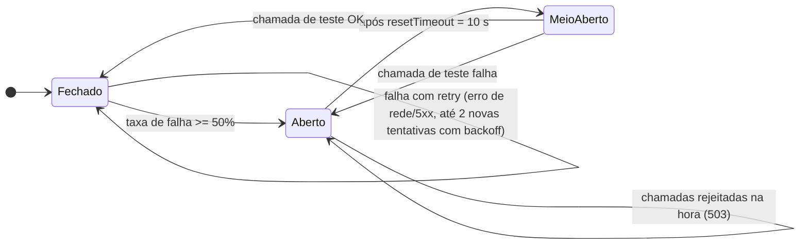
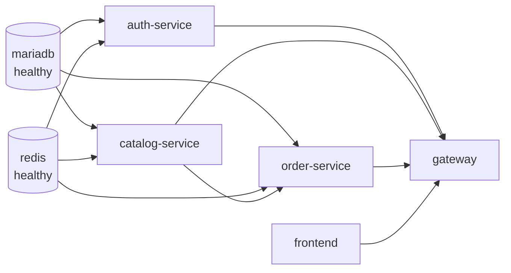

# Estratégias de resiliência

Lista das estratégias aplicadas, onde estão configuradas e qual falha cada uma trata.
Os cenários de teste correspondentes estão em
[`../arquitetura/quality-scenarios.md`](../arquitetura/quality-scenarios.md)
(QS-02, QS-03, QS-05, QS-08 e QS-12).

## Visão geral

| Estratégia | Onde | Configuração | Falha tratada |
|---|---|---|---|
| Timeout | Gateway (Nginx) | `proxy_connect_timeout 3s`, `proxy_read_timeout 30s` | Serviço travado não segura conexões do cliente |
| Timeout | `CatalogClient` (order-service) | `CATALOG_TIMEOUT_MS=2000` por tentativa (axios) | Catálogo lento |
| Timeout / fail-fast | Redis (ioredis) | `maxRetriesPerRequest: 2`, `enableOfflineQueue: false` | Comando preso esperando Redis indisponível |
| Retry com backoff exponencial | `CatalogClient` | `CATALOG_RETRIES=2`, apenas erro de rede e 5xx | Falhas transitórias do catálogo |
| Retry de conexão | ioredis | `retryStrategy` exponencial com teto de 5 s | Redis reiniciando |
| Retry de conexão | TypeORM | `retryAttempts: 10`, `retryDelay: 3000` | MariaDB ainda subindo ou reiniciando |
| Retry no proxy | Nginx | `proxy_next_upstream error timeout http_502 http_503` **só para GET** | Falha de conexão em leitura (idempotente) |
| Circuit breaker | `CatalogClient` (opossum) | `errorThresholdPercentage: 50`, `resetTimeout: 10s`, timeout próprio | Catálogo fora do ar: falha rápida em vez de acumular espera |
| Fallback | `CacheService.getOrSet` | Erro do Redis → `warn` + loader | Cache nunca derruba a requisição |
| Degradação controlada | order-service | 503 "Catálogo indisponível no momento. Tente novamente em instantes." | Checkout indisponível sem afetar catálogo e login |
| Idempotência (HTTP) | `POST /api/pedidos` | `Idempotency-Key` + `UNIQUE(usuario_id, idempotency_key)` | Duplo clique, retry do cliente |
| Idempotência (eventos) | auth e catalog | `eventos_processados(event_id PK)` | Evento reprocessado não soma em dobro |
| Isolamento de falha no consumidor | `EventBus.subscribe` | Handler em try/catch; erro logado | Um evento ruim não derruba a assinatura |
| Healthchecks + `depends_on: service_healthy` | Docker Compose | Banco, Redis, serviços, frontend e gateway | Serviço só recebe tráfego quando as dependências estão prontas |
| Reinício automático | Docker Compose | `restart: unless-stopped` | Crash de processo |
| Rate limiting | Gateway + `ThrottlerGuard` | `auth_limit` 10 r/min, `api_limit` 20 r/s; 100 req/60 s no serviço; 5/min em login/cadastro | Abuso e força bruta não esgotam recursos |
| Bulkhead (isolamento) | Arquitetura | Database e processo por serviço; conexão Redis dedicada para assinatura | Falha ou sobrecarga de um contexto não consome recursos dos outros |
| Encerramento gracioso | Nest `enableShutdownHooks` | Fecha conexões no SIGTERM | Deploy/restart sem requisições cortadas no meio |

## Checkout: retry + circuit breaker

Regras importantes:

- **Não repetir 4xx.** Um 404/422 do catálogo é resposta definitiva; repetir só gasta tempo.
- **Retry só em operação idempotente.** A chamada ao catálogo é `GET`; o `POST /api/pedidos`
  do cliente não é repetido pelo servidor — por isso existe o `Idempotency-Key`.
- **Orçamento de tempo:** com 2 s por tentativa e 2 retries, o pior caso fica em torno de
  6 s mais o backoff, abaixo do `proxy_read_timeout` de 30 s do gateway. Com o circuito
  aberto a resposta é imediata.
- **Cache de preços (30 s)** reduz a dependência: se o catálogo cair logo depois de uma
  consulta, compras das mesmas obras continuam funcionando até o TTL expirar.
- Logs esperados: `Circuit breaker OPEN`, `Circuit breaker HALF_OPEN`,
  `Circuit breaker CLOSED` (texto exato definido em `catalog.client.ts`).

A sequência completa está em [`../arquitetura/c4.md`](../arquitetura/c4.md#visão-dinâmica--checkout-post-apipedidos).

## Ordem de subida e dependências

Cada seta significa `depends_on` com `condition: service_healthy`.

## Limitações conhecidas (aceitas na v1.0.0)

| Limitação | Impacto | Evolução |
|---|---|---|
| Redis Pub/Sub não persiste mensagens | Evento publicado com consumidor desconectado é perdido (`total_gasto`/`total_vendido` ficam desatualizados) | Redis Streams com consumer group, ou Outbox |
| Publicação do evento após o commit, sem outbox | Se o processo morrer entre o commit e o publish, o evento não sai | Tabela `outbox` + publicador assíncrono |
| Uma instância de cada container | Sem redundância; restart causa indisponibilidade curta | Réplicas + upstream com vários `server` |
| Redis e MariaDB únicos | Ponto único de falha | Réplica / Sentinel / serviço gerenciado |
| Pagamento simulado | Não há compensação (saga) a tratar | Contexto de Pagamentos + saga |
