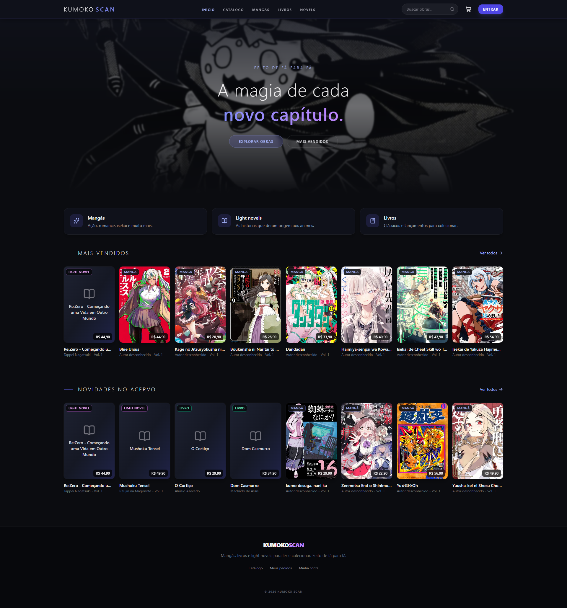
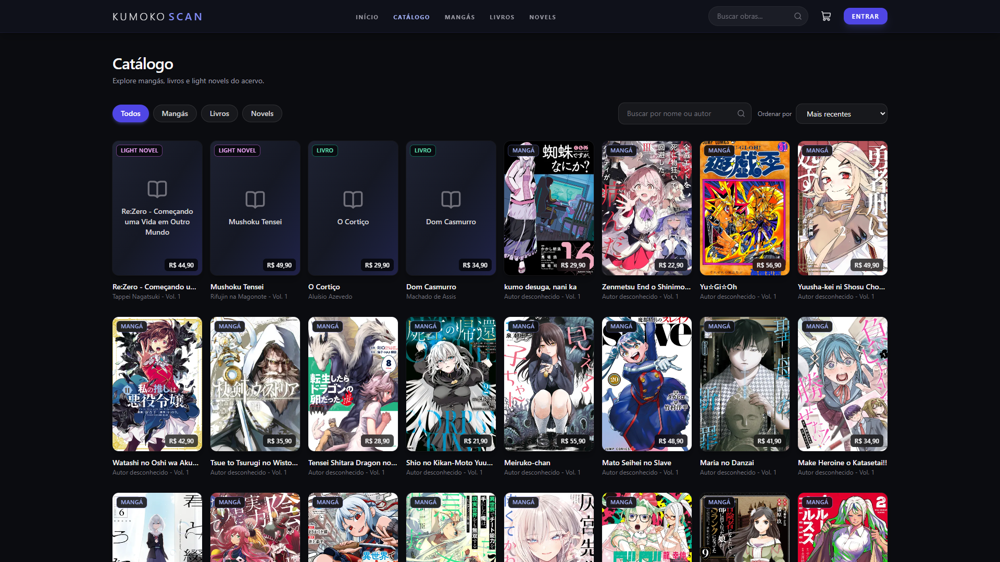
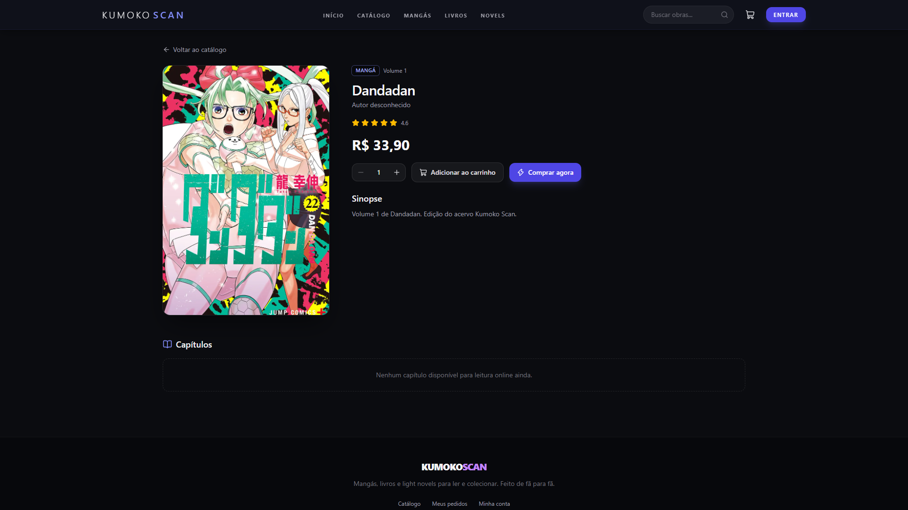

# Auditoria funcional da web — Kumoko Scan (2026-11)

Auditoria feita clicando no navegador (Playwright + Chrome) contra a stack completa
(`https://localhost:8443`), nas larguras de notebook e monitor (1366x768 e 1920x1080),
como **visitante**, **cliente** e **admin**, para os três tipos de obra (mangá, livro, light novel).
Tudo o que foi verificado virou teste E2E permanente em `frontend/e2e/`.

Foco do produto: web para notebook/monitor. Mobile não foi otimizado (continua responsivo, sem regressões conhecidas).

## 1. Resultado por área

Legenda: OK funciona · QUEBRADO falha ou não faz nada · INCOMPLETO funciona só em parte · INCOERENTE contradiz a regra do tipo de obra · VISUAL problema de layout.

| Área / tipo | Antes | O que foi feito | Depois |
|---|---|---|---|
| Home: hero, categorias, vitrines, "Ver todos" | OK; vitrines com 6 cards e muito espaço vazio em 1920 | Container mais largo em ≥1536 px; vitrine mostra 8 obras em 1920 e 6 em 1366 (1 linha cheia nas duas) | OK |
| Header: Início/Catálogo/Mangás/Livros/Novels, busca, carrinho, menu da conta | OK | Coberto por E2E (link ativo, aba ativa, filtro por tipo) | OK |
| Catálogo: abas, busca da página, ordenação, paginação, limpar filtros | OK; 18 por página deixava a última linha incompleta em 1920 (grade de 6/8 col.) | 24 por página (fecha linhas em 3, 4, 6 e 8 colunas); grade de 8 colunas em ≥1536 px | OK |
| Selo de tipo nos cards | VISUAL: ilegível sobre capas claras (fundo translúcido) | Fundo escuro quase opaco com borda na cor do tipo | OK |
| Cards/detalhe sem capa (livros e novels do seed) | VISUAL: retângulo vazio com ícone | Placeholder com o título da obra e gradiente da identidade | OK |
| Navegação rápida (vitrines + catálogo + leitor) | QUEBRADO: após ~100 requisições/min por IP o catálogo respondia 429 e as telas mostravam "Não foi possível carregar" | Leituras públicas do catálogo (lista, detalhe, lote, capítulos, páginas, todas em cache Redis) passam a ter limite próprio de 600/min por IP (`PUBLIC_READ_THROTTLE`); escritas e login seguem restritos | OK |
| Detalhe — Mangá | OK; sem atalho para começar a ler | Botão "Ler do início", contador de capítulos, lista em 2 colunas no desktop | OK |
| Detalhe — Light novel | OK | Mesmo do mangá | OK |
| Detalhe — Livro | INCOERENTE: seção "Capítulos" sempre vazia ("nenhum capítulo disponível"), botão de admin "Gerenciar capítulos" | Livro mostra "edição completa, sem leitura online"; sem seção de capítulos nem botão de gestão | OK |
| Leitor (mangá e novel) | OK; navegação com rótulo ambíguo ("Cap. 2") e sem teclado | Botões "Anterior: cap. N" / "Próximo: cap. N" e atalho ← / → no desktop | OK |
| Carrinho sem login | OK (redireciona para `/entrar?redirect=/carrinho`) | Coberto por E2E | OK |
| Cadastro (CPF, senha forte, confirmação, duplicado) e login/logout | OK | Coberto por E2E | OK |
| Perfil: nome, troca de senha com senha atual | OK | Coberto por E2E | OK |
| Perfil: "Total investido" | INCOMPLETO: mostrava o valor do login (não atualizava depois de comprar sem recarregar a página) | Perfil busca `/api/users/me` ao abrir | OK |
| Carrinho: 3 tipos, quantidades, remover, "Comprar agora", finalizar | OK | Coberto por E2E (total 68,25 conferido) | OK |
| Carrinho com obra excluída do acervo | QUEBRADO: item continuava com preço antigo e o checkout falhava com 422 | Item marcado "Indisponível", fora do total, finalização bloqueada até remover | OK |
| Pedidos: histórico | OK | Botão "Detalhes" em cada pedido | OK |
| Pedidos: detalhe | INEXISTENTE: não havia tela (a API `GET /api/pedidos/:id` não era usada) | Nova rota `/pedidos/:id` (404 amigável para pedido inexistente/de outro usuário) | OK |
| Admin: acervo (abas, busca, ordenar, paginação, excluir com confirmação) | OK; atalho "Capítulos" também para livros | Atalho de capítulos só para mangá/novel | OK |
| Admin: criar obra (3 tipos, com capa) | OK; após criar um livro abria a tela de capítulos | Livro volta ao acervo; manga/novel seguem para capítulos; dica de regra no campo Tipo | OK |
| Admin: editar (trocar capa, campos, mudar tipo) | OK; mudar para livro com capítulos deixava capítulos órfãos e invisíveis | Backend recusa com 409 e mensagem clara | OK |
| Admin: capítulos (criar, editar, excluir, duplicado) | OK; também abria para livros | Para livro mostra explicação; API recusa com 422 | OK |
| Admin: páginas (upload múltiplo, ver, excluir) | OK | Coberto por E2E e lido no leitor público | OK |
| Cliente em rotas de admin | OK ("Acesso restrito"; API 403) | Coberto por E2E | OK |
| Layout 1366 / 1920 | VISUAL: conteúdo preso em 1280 px no monitor | Containers principais `max-w-7xl 2xl:max-w-[96rem]`, detalhe com capa maior em 1920 | OK |

Itens decorativos sem função: nenhum link para página inexistente foi encontrado (rodapé, header e home apontam para rotas reais).

## 2. Decisões de regra de negócio por tipo de obra

Detalhes em [arquitetura/ddd.md §6.1](../arquitetura/ddd.md#61-regras-por-tipo-de-obra-decisão-de-2026-11-auditoria-funcional).

| Tipo | Volume | Capítulos / leitor online | Venda |
|---|---|---|---|
| Mangá | opcional | sim | sim |
| Light novel | opcional | sim | sim |
| Livro | não tem | **não** (edição completa) | sim |

- `POST /api/obras/:id/capitulos` em livro → **422**; mudar para livro uma obra com capítulos → **409**.
- Contrato §8 mantido (só foram acrescentados status de erro e a rota de tela `/pedidos/:id`, que usa um endpoint já existente).

## 3. Testes E2E (Playwright)

| Arquivo | Cobre |
|---|---|
| `e2e/visitante.spec.js` | home (hero, categorias, vitrines), links do header, abas, busca no header e na página, ordenações, paginação, detalhe dos 3 tipos, leitor de mangá e novel, 404, carrinho sem login → login |
| `e2e/cliente-conta.spec.js` | cadastro com validações e duplicado, login com senha errada/certa, logout, perfil (nome, troca de senha) |
| `e2e/cliente-compra.spec.js` | carrinho com os 3 tipos, quantidades, remoção, comprar agora, checkout, histórico, detalhe do pedido, total gasto, obra removida, bloqueio do admin |
| `e2e/admin-acervo.spec.js` | acervo (filtros, busca, ordenação, paginação) e criar/editar/excluir obra de cada tipo com capa |
| `e2e/admin-capitulos.spec.js` | capítulos e páginas de mangá e novel lidos no leitor; regra do livro (UI + API) e troca de tipo |

- 24 testes × 2 projetos (`desktop-1366`, `desktop-1920`) = **48 testes**. Duas rodadas seguidas locais: **48/48 e 48/48**.
- Dados: cada execução cria obras com nome único (`E2E <rótulo> <runId>`) via API do admin e as apaga no `afterAll`; um cliente novo é cadastrado no `global-setup`. Nenhum teste depende de outro arquivo.
- Login/cadastro têm throttle de 5/min por IP: os testes rodam com 1 worker, reaproveitam sessões salvas (`e2e/.auth/`, fora do git) e reenviam o formulário quando o backend responde 429.

### Como rodar

```bash
# stack no ar (docker compose up -d --wait) e, no frontend:
cd frontend
npm ci
npm run test:e2e                         # usa o Chrome instalado (channel "chrome")
npx playwright test --project=desktop-1920
npx playwright show-report               # relatório HTML (traces e screenshots das falhas)
```

Variáveis: `E2E_BASE_URL` (padrão `https://localhost:8443`), `E2E_BROWSER_CHANNEL`
(`chrome` padrão; `chromium` no CI, após `npx playwright install --with-deps chromium`),
`E2E_ADMIN_EMAIL`/`E2E_ADMIN_PASSWORD` (padrão: `ADMIN_*` do `.env` da raiz).

No CI (`compose-smoke`), os E2E rodam depois do smoke test; em falha, `playwright-report`
e `test-results` (traces) são publicados como artifact.

## 4. Telas finais (1920x1080)






## 5. Pendências (dependem de decisão)

- O seed não cria capítulos: um visitante numa instalação nova não encontra nenhum capítulo para ler até o admin publicar. Criar capítulos de exemplo exige imagens de páginas com licença de uso.
- Livros e novels do seed não têm capa (aparecem com o placeholder com título).
- Light novels usam o mesmo leitor de imagens dos mangás. Leitura de novel em texto seria um recurso novo (outro modelo de conteúdo).
