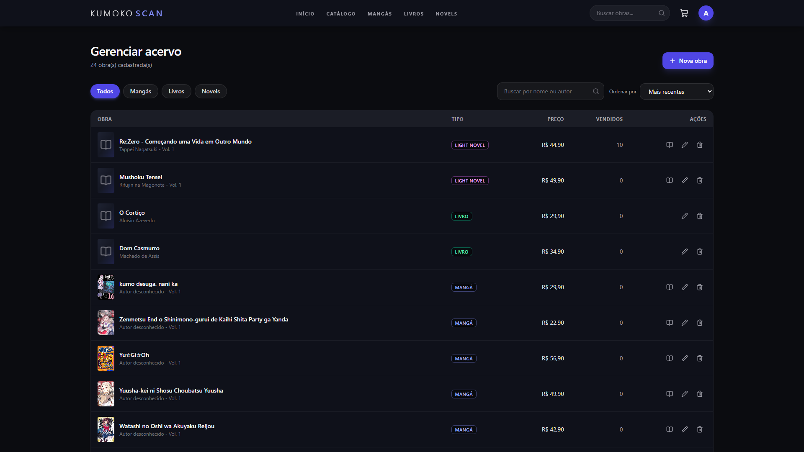
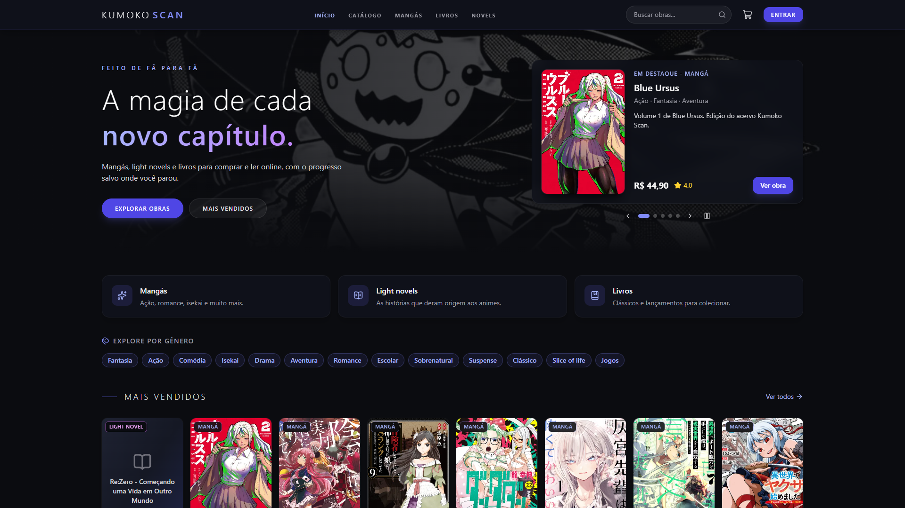
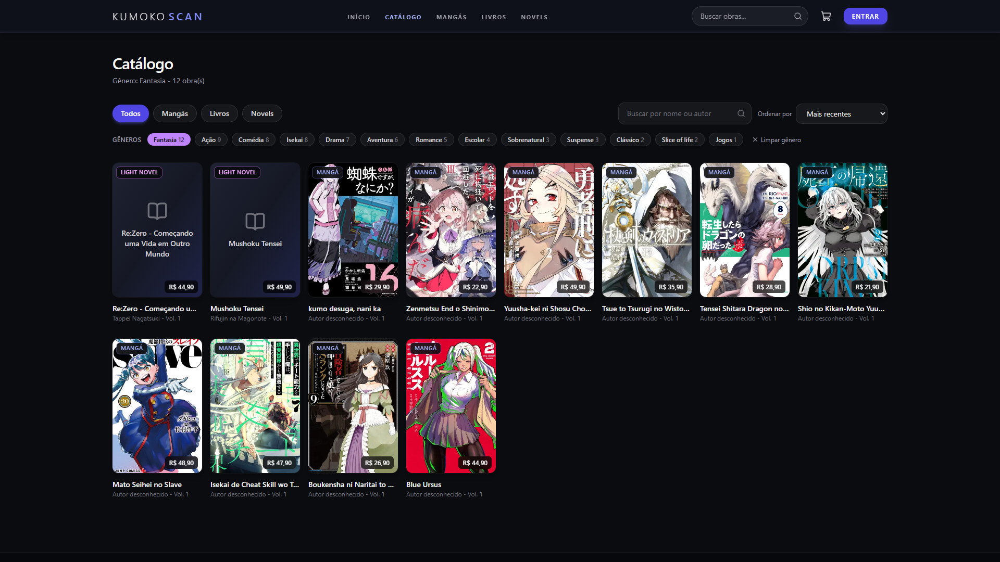
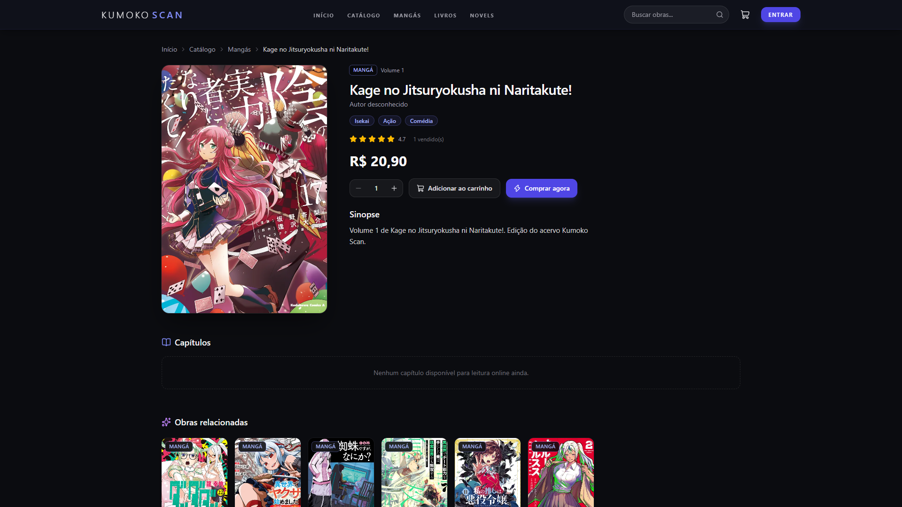
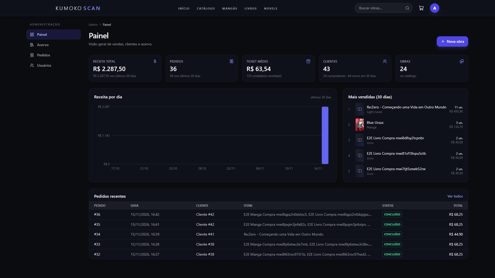
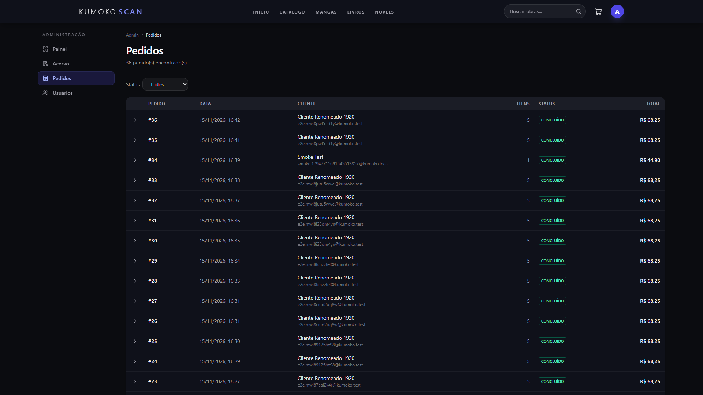
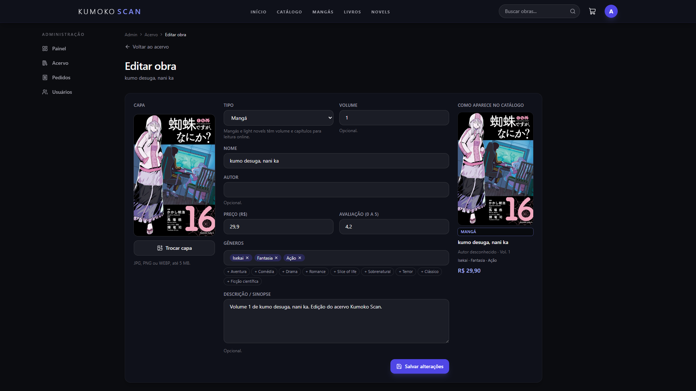

# Auditoria funcional da web — Kumoko Scan (2026-11)

Auditoria feita clicando no navegador (Playwright + Chrome) contra a stack completa
(`https://localhost:8443`), nas larguras de notebook e monitor (1366x768 e 1920x1080),
como **visitante**, **cliente** e **admin**, para os três tipos de obra (mangá, livro, light novel).
Tudo o que foi verificado virou teste E2E permanente em `frontend/e2e/`.

Foco do produto: web para notebook/monitor. Mobile não foi otimizado (continua responsivo, sem regressões conhecidas).

## 1. Resultado por área

Legenda: OK funciona · QUEBRADO falha ou não faz nada · INCOMPLETO funciona só em parte · INCOERENTE contradiz a regra do tipo de obra · VISUAL problema de layout.

| Área / tipo | Antes | O que foi feito | Depois |
|---|---|---|---|
| Home: hero, categorias, vitrines, "Ver todos" | OK; vitrines com 6 cards e muito espaço vazio em 1920 | Container mais largo em ≥1536 px; vitrine mostra 8 obras em 1920 e 6 em 1366 (1 linha cheia nas duas) | OK |
| Header: Início/Catálogo/Mangás/Livros/Novels, busca, carrinho, menu da conta | OK | Coberto por E2E (link ativo, aba ativa, filtro por tipo) | OK |
| Catálogo: abas, busca da página, ordenação, paginação, limpar filtros | OK; 18 por página deixava a última linha incompleta em 1920 (grade de 6/8 col.) | 24 por página (fecha linhas em 3, 4, 6 e 8 colunas); grade de 8 colunas em ≥1536 px | OK |
| Selo de tipo nos cards | VISUAL: ilegível sobre capas claras (fundo translúcido) | Fundo escuro quase opaco com borda na cor do tipo | OK |
| Cards/detalhe sem capa (livros e novels do seed) | VISUAL: retângulo vazio com ícone | Placeholder com o título da obra e gradiente da identidade | OK |
| Navegação rápida (vitrines + catálogo + leitor) | QUEBRADO: após ~100 requisições/min por IP o catálogo respondia 429 e as telas mostravam "Não foi possível carregar" | Leituras públicas do catálogo (lista, detalhe, lote, capítulos, páginas, todas em cache Redis) passam a ter limite próprio de 600/min por IP (`PUBLIC_READ_THROTTLE`); escritas e login seguem restritos | OK |
| Detalhe — Mangá | OK; sem atalho para começar a ler | Botão "Ler do início", contador de capítulos, lista em 2 colunas no desktop | OK |
| Detalhe — Light novel | OK | Mesmo do mangá | OK |
| Detalhe — Livro | INCOERENTE: seção "Capítulos" sempre vazia ("nenhum capítulo disponível"), botão de admin "Gerenciar capítulos" | Livro mostra "edição completa, sem leitura online"; sem seção de capítulos nem botão de gestão | OK |
| Leitor (mangá e novel) | OK; navegação com rótulo ambíguo ("Cap. 2") e sem teclado | Botões "Anterior: cap. N" / "Próximo: cap. N" e atalho ← / → no desktop | OK |
| Carrinho sem login | OK (redireciona para `/entrar?redirect=/carrinho`) | Coberto por E2E | OK |
| Cadastro (CPF, senha forte, confirmação, duplicado) e login/logout | OK | Coberto por E2E | OK |
| Perfil: nome, troca de senha com senha atual | OK | Coberto por E2E | OK |
| Perfil: "Total investido" | INCOMPLETO: mostrava o valor do login (não atualizava depois de comprar sem recarregar a página) | Perfil busca `/api/users/me` ao abrir | OK |
| Carrinho: 3 tipos, quantidades, remover, "Comprar agora", finalizar | OK | Coberto por E2E (total 68,25 conferido) | OK |
| Carrinho com obra excluída do acervo | QUEBRADO: item continuava com preço antigo e o checkout falhava com 422 | Item marcado "Indisponível", fora do total, finalização bloqueada até remover | OK |
| Pedidos: histórico | OK | Botão "Detalhes" em cada pedido | OK |
| Pedidos: detalhe | INEXISTENTE: não havia tela (a API `GET /api/pedidos/:id` não era usada) | Nova rota `/pedidos/:id` (404 amigável para pedido inexistente/de outro usuário) | OK |
| Admin: acervo (abas, busca, ordenar, paginação, excluir com confirmação) | OK; atalho "Capítulos" também para livros | Atalho de capítulos só para mangá/novel | OK |
| Admin: criar obra (3 tipos, com capa) | OK; após criar um livro abria a tela de capítulos | Livro volta ao acervo; manga/novel seguem para capítulos; dica de regra no campo Tipo | OK |
| Admin: editar (trocar capa, campos, mudar tipo) | OK; mudar para livro com capítulos deixava capítulos órfãos e invisíveis | Backend recusa com 409 e mensagem clara | OK |
| Admin: capítulos (criar, editar, excluir, duplicado) | OK; também abria para livros | Para livro mostra explicação; API recusa com 422 | OK |
| Admin: páginas (upload múltiplo, ver, excluir) | OK | Coberto por E2E e lido no leitor público | OK |
| Cliente em rotas de admin | OK ("Acesso restrito"; API 403) | Coberto por E2E | OK |
| Layout 1366 / 1920 | VISUAL: conteúdo preso em 1280 px no monitor | Containers principais `max-w-7xl 2xl:max-w-[96rem]`, detalhe com capa maior em 1920 | OK |

Itens decorativos sem função: nenhum link para página inexistente foi encontrado (rodapé, header e home apontam para rotas reais).

## 2. Decisões de regra de negócio por tipo de obra

Detalhes em [arquitetura/ddd.md §6.1](../arquitetura/ddd.md#61-regras-por-tipo-de-obra-decisão-de-2026-11-auditoria-funcional).

| Tipo | Volume | Capítulos / leitor online | Venda |
|---|---|---|---|
| Mangá | opcional | sim | sim |
| Light novel | opcional | sim | sim |
| Livro | não tem | **não** (edição completa) | sim |

- `POST /api/obras/:id/capitulos` em livro → **422**; mudar para livro uma obra com capítulos → **409**.
- Contrato §8 mantido (só foram acrescentados status de erro e a rota de tela `/pedidos/:id`, que usa um endpoint já existente).

## 3. Testes E2E (Playwright)

| Arquivo | Cobre |
|---|---|
| `e2e/visitante.spec.js` | home (hero, categorias, vitrines), links do header, abas, busca no header e na página, ordenações, paginação, detalhe dos 3 tipos, leitor de mangá e novel, 404, carrinho sem login → login |
| `e2e/cliente-conta.spec.js` | cadastro com validações e duplicado, login com senha errada/certa, logout, perfil (nome, troca de senha) |
| `e2e/cliente-compra.spec.js` | carrinho com os 3 tipos, quantidades, remoção, comprar agora, checkout, histórico, detalhe do pedido, total gasto, obra removida, bloqueio do admin |
| `e2e/admin-acervo.spec.js` | acervo (filtros, busca, ordenação, paginação) e criar/editar/excluir obra de cada tipo com capa |
| `e2e/cliente-melhorias.spec.js` | gêneros (API, filtro, chips), relacionadas, busca com sugestões, destaque da home, capítulos (busca/ordem/último lido), leitor (modo, largura, progresso, continuar lendo) |
| `e2e/admin-capitulos.spec.js` | capítulos e páginas de mangá e novel lidos no leitor; regra do livro (UI + API) e troca de tipo |

- 24 testes × 2 projetos (`desktop-1366`, `desktop-1920`) = **48 testes**. Duas rodadas seguidas locais: **48/48 e 48/48**.
- Dados: cada execução cria obras com nome único (`E2E <rótulo> <runId>`) via API do admin e as apaga no `afterAll`; um cliente novo é cadastrado no `global-setup`. Nenhum teste depende de outro arquivo.
- Login/cadastro têm throttle de 5/min por IP: os testes rodam com 1 worker, reaproveitam sessões salvas (`e2e/.auth/`, fora do git) e reenviam o formulário quando o backend responde 429.

### Como rodar

```bash
# stack no ar (docker compose up -d --wait) e, no frontend:
cd frontend
npm ci
npm run test:e2e                         # usa o Chrome instalado (channel "chrome")
npx playwright test --project=desktop-1920
npx playwright show-report               # relatório HTML (traces e screenshots das falhas)
```

Variáveis: `E2E_BASE_URL` (padrão `https://localhost:8443`), `E2E_BROWSER_CHANNEL`
(`chrome` padrão; `chromium` no CI, após `npx playwright install --with-deps chromium`),
`E2E_ADMIN_EMAIL`/`E2E_ADMIN_PASSWORD` (padrão: `ADMIN_*` do `.env` da raiz).

No CI (`compose-smoke`), os E2E rodam depois do smoke test; em falha, `playwright-report`
e `test-results` (traces) são publicados como artifact.

## 4. Telas finais (1920x1080)




## 5. Pendências (dependem de decisão)

- O seed não cria capítulos: um visitante numa instalação nova não encontra nenhum capítulo para ler até o admin publicar. Criar capítulos de exemplo exige imagens de páginas com licença de uso.
- Livros e novels do seed não têm capa (aparecem com o placeholder com título).
- Light novels usam o mesmo leitor de imagens dos mangás. Leitura de novel em texto seria um recurso novo (outro modelo de conteúdo).

## 6. Melhorias de UX do cliente (2026-11-15)

Diagnóstico feito com Playwright (Chrome) em 1366x768 e 1920x1080 nas telas do cliente.

| Área | Antes | Depois |
|---|---|---|
| Home | Hero de 55vh só com imagem e slogan; CTA "Explorar obras" com contraste baixo; duas vitrines | Hero em duas colunas com **destaque rotativo de obras reais** (mais vendidas com capa; pausa no hover/foco, botões anterior/próximo/pausar, respeita `prefers-reduced-motion`), CTA primário sólido, **Continuar lendo**, **Explore por gênero** e vitrine **Light novels** |
| Catálogo | Só tipo, busca e ordenação | **Filtro por gênero** (`?genero=` na URL, contagem por gênero, combinável com tipo/busca/ordem, "Limpar gênero") |
| Busca do header | Só Enter → catálogo | **Sugestões com debounce** (5 obras com capa, tipo, autor e preço), setas/Enter/Esc, "Ver todos os N resultados" |
| Detalhe | "Voltar ao catálogo"; sinopse fixa; lista de capítulos simples; nada a seguir | **Trilha** (Início › Catálogo › Tipo › Obra), **chips de gênero** clicáveis, **sinopse expansível**, **Continuar leitura: cap. X, pág. Y/Z**, capítulos com **busca** (≥ 8), **ordem** e selo **Último lido**, skeleton, **Obras relacionadas** |
| Leitor | Só rolagem vertical, largura fixa, setas sem documentação | **Modo rolagem contínua / página a página** (clique nas metades ou setas), **largura** (estreita/média/larga, tecla L), **barra de progresso**, "Página N de M", **atalhos documentados** na tela, **retomar da página salva**, **pré-carregamento** do próximo capítulo (na metade) e da próxima página |
| Progresso | Inexistente | Salvo por obra no `localStorage` (visitante e cliente; não sincroniza entre dispositivos) |
| Acessibilidade | — | Carrossel com `aria-roledescription`, chips com `aria-pressed`, listbox com `aria-activedescendant`, progressbar com valores, animações desligadas com `prefers-reduced-motion` |

Backend (catalog-service): migration `1763300000000-AddGeneros` (coluna `generos` JSON, preenche as obras do seed por nome),
`generos` em `ObraResponse`, multipart `generos` ("Ação, Fantasia"; normaliza caixa e duplicados; máx. 8), filtro
`GET /api/obras?genero=` (sem diferenciar caixa/acento), `GET /api/obras/generos` e `GET /api/obras/:id/relacionadas?limit=`
(2 pontos por gênero em comum + 1 por mesmo tipo), todos com cache-aside sob `catalog:obras:` (invalidados em qualquer escrita).

Testes: `e2e/cliente-melhorias.spec.js` — 7 testes × 2 resoluções (API de gêneros/relacionadas/cache, filtro do catálogo,
detalhe, capítulos, busca com sugestões, destaque da home, leitor/progresso). Unitários do catalog-service: 111.





Pendências (a confirmação/tela de sucesso do checkout foi **resolvida** — ver §8): drawer de carrinho no header e confirmação/tela de sucesso do checkout não foram feitos nesta rodada;
o progresso de leitura não sincroniza entre dispositivos (exigiria endpoint no auth-service).

## 7. Melhorias do painel administrativo (2026-11-15)

Diagnóstico (Playwright, 1366 e 1920, antes): a área admin era só o acervo, acessível apenas pelo menu da conta; usava o
layout do cliente com conteúdo centralizado e muito espaço vazio em 1920; não havia nenhuma visão de vendas, pedidos de
todos os clientes ou gestão de usuários; tabela com linhas altas (~9 obras por tela) e ordenação só pelo select; o
formulário de obra validava apenas no envio, não mostrava como o card apareceria e não tinha gêneros.

| Área | Antes | Depois |
|---|---|---|
| Navegação | `/admin` redirecionava para o acervo; sem menu próprio | **Layout admin** com sidebar (Painel, Acervo, Pedidos, Usuários), trilha (Admin › Acervo › Editar obra) e largura até 1760px |
| Painel `/admin` | Inexistente | **KPIs reais** (receita total, pedidos, ticket médio, clientes, obras), **receita por dia (30 dias)** com tooltip e tabela acessível, **top 5 obras**, **pedidos recentes** com nome do cliente |
| Pedidos `/admin/pedidos` | Inexistente | Todos os pedidos paginados, filtro por **status** e **cliente** (clicar no cliente filtra), linha expansível com itens, capa, quantidade × preço e subtotal |
| Usuários `/admin/usuarios` | Inexistente | Busca por nome/e-mail, filtro por papel, ordenação (recentes, nome, maior gasto), total gasto, cadastro, atalho para os pedidos do cliente; **promover/rebaixar** com diálogo de confirmação; botão desabilitado para si mesmo |
| Acervo | Ordenação só pelo select; linhas altas | Cabeçalhos **Obra / Preço / Vendidos clicáveis** (`aria-sort`), linhas mais densas |
| Form de obra | Validação só no envio | Validação **ao sair do campo** e, após a 1ª tentativa, **a cada tecla**; **gêneros como tags** (Enter/vírgula, sugestões, máx. 8); **prévia do card** do catálogo (≥ 1536px) |

Backend:
- order-service — `GET /api/pedidos/admin/resumo?dias=` (1..365, padrão 30; SQL agregado só de pedidos CONCLUIDO, dias
  em UTC sem lacunas, cache em memória de 15s) e `GET /api/pedidos/admin?page&limit&status&usuarioId`; controller
  separado `@Roles('admin')` registrado antes de `/pedidos/:id`; port `PedidoRepository.listarTodos`.
- auth-service — `GET /api/users/admin/resumo`, `GET /api/users/admin?page&limit&busca&role&ids&ordenar` e
  `PATCH /api/users/:id/role` (400 ao alterar o próprio papel; 409 se removeria o último admin — contagem com lock
  pessimista na mesma transação). A listagem fica em `/users/admin` porque o gateway redireciona `/api/users` (301).
- Sem migrations novas. Swagger nos dois serviços e `docs/api/openapi.yaml` (tag Admin).

Testes: unitários novos `pedidos-admin.service.spec.ts` (4) e `admin-usuarios.service.spec.ts` (8); E2E
`e2e/admin-painel.spec.js` — 5 testes × 2 resoluções (KPIs × API e sidebar, pedidos com detalhe/filtros, usuários
promover/rebaixar/autoproteção, validação em tempo real + gêneros criar/editar, 403 para cliente em todas as rotas admin).





Pendências (reordenação de páginas e `totalCapitulos` foram **resolvidos** — ver §8): reordenar páginas de um capítulo exige endpoint no catalog-service (ex.: `PATCH /api/paginas/:id { numero }`
ou `PUT /api/capitulos/:id/paginas/ordem`); contador de capítulos por obra no acervo exige o campo `totalCapitulos` em
`ObraResponse`; a troca de papel só vale no próximo login (o JWT atual mantém o papel até expirar — revogar exigiria
versão de token/denylist); o menu da conta ainda leva direto a "Gerenciar acervo" (arquivo do header, outra frente).

## 8. Pendências resolvidas (2026-11-15)

Fecha as pendências das seções 6 e 7 que dependiam de backend/fluxos novos.

| Pendência | Status | Solução |
|---|---|---|
| Reordenar páginas de um capítulo (§7) | **Resolvida** | `PUT /api/capitulos/:id/paginas/ordem` `{ paginaIds }` (admin). Exige exatamente todas as páginas do capítulo, sem repetição (400 caso contrário; 404 capítulo inexistente). Em uma transação com lock pessimista: desloca todas para `numero + 1000000` e grava 1..N, sem colidir com `UNIQUE(capitulo_id, numero)`. Invalida `catalog:capitulos:paginas:<id>` e `catalog:obras:capitulos:<obraId>`. No admin (Páginas do capítulo): **arrastar e soltar** (HTML5 DnD) e botões **mover para cima/baixo** (teclado), "Ordem alterada (não salva)", **Salvar ordem**/**Desfazer**, anúncio em `aria-live`. O leitor passa a exibir a nova ordem |
| Contador de capítulos no acervo (§7) | **Resolvida** | `totalCapitulos` em `ObraResponse` (listas, detalhe, relacionadas e lote) via **um único** `COUNT ... GROUP BY obra_id` por resposta (sem N+1); 0 para livro. Criar/excluir capítulo invalida `catalog:obras:`. Coluna **Capítulos** no acervo admin (após "Vendidos"; "—" para livro) |
| Confirmação e tela de sucesso do checkout (§6) | **Resolvida** | "Finalizar compra" abre **modal de confirmação** (itens, quantidade × preço, total estimado e aviso de que o preço final vem do catálogo; Esc/"Voltar ao carrinho" cancela). Após o pedido: `/pedidos/:id/sucesso` com número, itens, total pago, **Ver meus pedidos** e **Continuar comprando**. A `Idempotency-Key` continua estável enquanto o carrinho não muda |
| Upload de páginas sem feedback por arquivo | **Resolvida** | Lista de envio com **barra de progresso por arquivo** (`onUploadProgress`, `role="progressbar"`), status **Aguardando/Enviando/Enviada/Erro** com a mensagem do servidor, e **Tentar novamente** apenas para os que falharam |

Testes: unitários novos no catalog-service (`paginas.service.spec.ts` +3: reordenação com offset antes da renumeração,
validação 400 e 404; `obras.service.spec.ts` +1: COUNT agrupado único). E2E `e2e/pendencias.spec.js` — 5 testes × 2
resoluções (API de reordenação/validação/cache/401, reordenação na UI por teclado e arrastar + leitor, `totalCapitulos`
na API e no acervo, upload com falha simulada e retry, checkout com modal/cancelamento/idempotency key/tela de sucesso).
`e2e/cliente-compra.spec.js` foi ajustado ao novo fluxo (modal → `/pedidos/:id/sucesso` → "Ver meus pedidos").

Pendências que continuam: drawer de carrinho no header; progresso de leitura sem sincronização entre dispositivos;
troca de papel só vale no próximo login; menu da conta ainda leva direto a "Gerenciar acervo".
